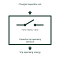

# Capacitor-trip operating interface

Uses stored electrical energy in a documented capacitor-trip unit to support an opening operation.

[Canonical reference](https://eloragrid.ai/symbols/capacitor-trip-operating-interface) · [Structured record](../entries/capacitor-trip-operating-interface.json) · [All references](README.md)

Updated: 2026-11-03. Drawing use: Schematic. Reference families: Manufacturer.

Representation: functional-block; installation focus: switchgear.
Charged capacitor unit
Trip operating energy

## What it represents

Uses stored electrical energy in a documented capacitor-trip unit to support an opening operation. A switching-device operating reference adds the specific mechanism or duty context needed to interpret its place in a power circuit. The same basic switching outline can serve different equipment constructions, so the added description must remain attached to its device tag.
In a medium-voltage switchgear drawing, the operating reference helps the reader distinguish the interrupting device from its isolation, earthing and auxiliary-control interfaces. For this reference, the drawing identifies “Charged capacitor unit” at the input and “Trip operating energy” at the output. Stored charge requires its own supervision and handling rules.
Use the device schedule for its actual construction, operating duty and ratings. These original functional illustrations describe the named role and do not certify a standard glyph or product footprint. The functional block is an independent explanation of this named application. Equipment-specific ratings, terminal connections and operating conditions must be established in the project documentation.

## How to read it

- Start at the named input: Charged capacitor unit. Identify its source device or document and the state represented on the drawing.
- Follow the named output: Trip operating energy. Cross-reference its destination and separate the command from confirmation that the equipment responded.
- Stored charge requires its own supervision and handling rules.
- Use the device schedule for its actual construction, operating duty and ratings. These original functional illustrations describe the named role and do not certify a standard glyph or product footprint.

## Drawing checklist

- Label the source and connection reference for charged capacitor unit.
- Identify the destination and defined state of trip operating energy.
- Record the equipment or control-document revision supporting this functional block.
- Check this application limit in the project design: Stored charge requires its own supervision and handling rules.

## Important distinction

Stored charge requires its own supervision and handling rules. This reference describes the named application; it does not establish a new IEC graphical symbol, an ANSI device-function number or an exact manufacturer connection diagram.

## Facts

- Representation: Functional block
- Installation focus: Switchgear
- Input / boundary: Charged capacitor unit
- Output / connection: Trip operating energy
- Lookup label: COI is a library lookup label, not a standard device designation.

## Public references

- [High-voltage circuit breakers](https://www.siemens-energy.com/global/en/home/products-services/product-offerings/circuit-breakers.html) — Siemens Energy. Public technical context for switching-device operating references. Circuit-breaker construction and interruption families. The application text and educational graphic are independently authored; the publisher does not certify this representation.

## Related references

- [Circuit breaker](circuit-breaker.md)
- [Disconnector](disconnector.md)
- [Undervoltage-release holding interface](undervoltage-release-holding-interface.md)

Original educational concept geometry, CC BY 4.0. Unitless; not a certified standards glyph or manufacturer footprint.

Elora-authored explanations are CC BY 4.0. Linked standards and manufacturer material retain their own rights. Confirm project requirements using primary sources.
