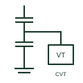

# Capacitor voltage transformer

An instrument transformer using a capacitive voltage divider and an electromagnetic unit to supply documented voltage measurement or protection signals.

[Canonical reference](https://eloragrid.ai/symbols/capacitor-voltage-transformer) · [Structured record](../entries/capacitor-voltage-transformer.json) · [All references](README.md)

Updated: 2026-10-27. Drawing use: SLD, Schematic. Reference families: Manufacturer.

## What it represents

A capacitor voltage transformer combines a capacitive divider with an electromagnetic unit to provide voltage signals for its documented metering or protection application. Manufacturer arrangements may also provide interfaces for power-line carrier equipment.
In a single line diagram, identify the high-voltage connection and the measurement or protection circuits served by the secondary outputs. The conceptual preview illustrates the operating arrangement; it is not a certified standard symbol or a manufacturer connection drawing.

## How to read it

- Distinguish the capacitive divider and electromagnetic unit from a standalone coupling capacitor.
- Trace the secondary circuits and any carrier interface using the selected model documentation rather than assuming they share the same connection.

## Drawing checklist

- Identify the exact CVT/CCVT equipment tag and the voltage circuit represented.
- Reference the specified primary/secondary arrangement, measurement duties and secondary earthing details.
- Cross-reference the manufacturer terminal diagram and any documented carrier or damping-system interfaces.

## Important distinction

An inductive voltage transformer and a capacitor voltage transformer can both supply voltage signals, but their operating arrangements and transient behaviour differ. A coupling capacitor alone is not a complete CVT.

## Facts

- Operating arrangement: Capacitive divider plus electromagnetic unit; exact construction depends on manufacturer design
- Code scope: CVT and CCVT are common equipment abbreviations, not an assigned graphical-symbol identifier
- Preview scope: Independently drawn functional concept; not official standard artwork

## Public references

- [CPB capacitor voltage transformer](https://www.hitachienergy.com/uk-ie/en/products-and-solutions/instrument-transformers/voltage-transformers/cpb-72-800-kv) — Hitachi Energy. Public CVT application description supports metering, protection and optional carrier context.
- [CCV/CVT and coupling capacitors brochure](https://www.gevernova.com/grid-solutions/sites/default/files/2025-09/CCV-CVT-And-CC-Coupling-Capacitors-Brochure-EN-N50166-Hybrid-202505-R002.pdf) — GE Vernova. Public manufacturer construction explanation supports the divider/electromagnetic-unit distinction.

## Related references

- [Voltage transformer](voltage-transformer.md)
- [Capacitor](capacitor.md)
- [Current transformer](current-transformer.md)

Original educational concept geometry, CC BY 4.0. Unitless; not a certified standards glyph or manufacturer footprint.

Elora-authored explanations are CC BY 4.0. Linked standards and manufacturer material retain their own rights. Confirm project requirements using primary sources.
