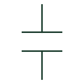

# Capacitor

A capacitive component or bank identified with its circuit function and ratings.

[Canonical reference](https://eloragrid.ai/symbols/capacitor) · [Structured record](../entries/capacitor.json) · [All references](README.md)

Updated: 2026-10-27. Drawing use: SLD, Schematic. Reference families: IEC, IEEE / ANSI.

## What it represents

A capacitor representation identifies a capacitive component or arrangement in a circuit. Polarised, non-polarised, adjustable and other variants need the appropriate representation and annotations. In power drawings a capacitor bank is a system assembly, rather than merely a scaled-up generic component mark.
Ratings, discharge arrangements, switching and associated reactors or protection depend on the application and selected equipment. A symbol is an identification aid; it does not provide those design values.

## How to read it

- Identify whether the drawing denotes a component or a bank assembly.
- Read polarity or adjustable features only where the selected variant documents them.

## Drawing checklist

- Reference the component or bank rating.
- Identify any switching and associated protective equipment.
- Link the equipment documentation for discharge or reactor arrangements.

## Important distinction

A capacitor-bank representation does not identify every component of the assembled bank or establish its switching duty.

## Facts

- Variant: Application-specific
- Polarity: Must be explicitly represented where relevant
- Ratings: Separate equipment data
- Public Autodesk reference names: HCA1, VCA1 (vendor identifiers, not IEC symbol IDs)

## Public references

- [Capacitive component symbols](https://help.autodesk.com/cloudhelp/2021/ENU/AutoCAD-Electrical/files/GUID-74580D46-0731-41A6-918D-2DB419114207.htm) — Autodesk. Public capacitor categories and variants.

## Related references

- [Busbar](busbar.md)
- [Circuit breaker](circuit-breaker.md)
- [Resistor](resistor.md)
- [Power transformer](power-transformer.md)

Original educational concept geometry, CC BY 4.0. Unitless; not a certified standards glyph or manufacturer footprint.

Elora-authored explanations are CC BY 4.0. Linked standards and manufacturer material retain their own rights. Confirm project requirements using primary sources.
