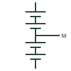

# Centre-tapped battery bank

A battery bank with a mid-point connection that provides positive and negative rails about a common centre point.

[Canonical reference](https://eloragrid.ai/symbols/centre-tapped-battery-bank) · [Structured record](../entries/centre-tapped-battery-bank.json) · [All references](README.md)

Updated: 2026-10-28. Drawing use: SLD, Schematic. Reference families: IEC, IEEE / ANSI.

## What it represents

A centre-tapped battery bank brings out a connection at the middle of the series chain, giving positive and negative rails referred to that point. It is used in some UPS rectifier-inverter designs, three-level converters and telecom or substation DC systems that need a symmetric supply or a defined midpoint for earth-fault detection.
Drawings show the battery symbol split into two halves with a lead taken from the junction, often labelled N, M or 0 V. The midpoint may be earthed, earthed through a resistance or left floating with an insulation monitor, and the drawing should state which.
The symbol does not show how the two halves are kept balanced. Unequal loading on the two rails discharges one half faster, and the midpoint earthing method changes how an earth fault on either rail behaves.

## How to read it

- Identify how the midpoint is earthed or monitored.
- Check whether loads draw from one half only.

## Drawing checklist

- State voltage of each half and total.
- Show midpoint earthing or monitoring.
- Reference balancing and fault detection.

## Important distinction

A centre-tapped bank has a usable midpoint; an ordinary battery string presents only positive and negative terminals.

## Facts

- Terminals: Positive, midpoint, negative
- Common uses: UPS DC links, three-level converters
- Midpoint treatment: Earthed, resistance-earthed or floating
- Preview: Independent educational illustration; consult the applicable standard and project legend for the exact graphic

## Public references

- [IEC graphical symbols for diagrams](https://tc3.iec.ch/tc-activity/graphical-symbols-for-diagrams/) — IEC. IEC graphical symbol context for batteries.
- [Multilevel NPC converter application context](https://www.infineon.com/product-information/sic-modules-for-ups-design-and-efficiency-guide) — Infineon Technologies. Public three-level converter context requiring a DC midpoint.

## Related references

- [Battery](battery.md)
- [Neutral-point-clamped inverter](neutral-point-clamped-inverter.md)
- [Battery insulation monitoring function](battery-insulation-monitor.md)

Original educational concept geometry, CC BY 4.0. Unitless; not a certified standards glyph or manufacturer footprint.

Elora-authored explanations are CC BY 4.0. Linked standards and manufacturer material retain their own rights. Confirm project requirements using primary sources.
