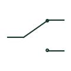

# Changeover contact

A contact arrangement switching a common connection between two contact paths.

[Canonical reference](https://eloragrid.ai/symbols/changeover-contact) · [Structured record](../entries/changeover-contact.json) · [All references](README.md)

Updated: 2026-10-27. Drawing use: Schematic. Reference families: IEC, IEEE / ANSI.

## What it represents

A changeover contact connects a common terminal to one of two alternative contact paths according to its operating state. Form C and SPDT are terms commonly encountered for this arrangement. The actual terminal numbering and transfer behaviour come from the selected device.
The schematic should make the common terminal and normal state clear. A mirrored or differently oriented drawing can retain the same logical arrangement, but terminal associations must not be inferred from appearance alone.

## How to read it

- Locate the common terminal and determine the path shown in the defined normal state.
- Use device data to identify transfer timing and any special overlap behaviour.

## Drawing checklist

- Identify the common terminal.
- Link both switched paths to the parent device.
- Keep terminal identifiers consistent with wiring documentation.

## Important distinction

Two unrelated NO/NC contacts are not automatically one changeover contact. Confirm whether they share a common connection and operating mechanism.

## Facts

- Connections: Common and two alternative paths
- Alternative terms: Form C; SPDT
- Transfer characteristics: Device-specific
- Public Autodesk reference names: HCR23R, VCR23R (vendor identifiers, not IEC symbol IDs)

## Public references

- [Relays and contacts: public symbol reference](https://help.autodesk.com/cloudhelp/2021/ENU/AutoCAD-Electrical/files/GUID-011C62B8-9EC8-485C-B47D-B22A3F7B7574.htm) — Autodesk. Public Form C relay contact variants.

## Related references

- [Normally open contact](normally-open-contact.md)
- [Normally closed contact](normally-closed-contact.md)
- [Selector switch](selector-switch.md)
- [Relay coil](relay-coil.md)

Original educational concept geometry, CC BY 4.0. Unitless; not a certified standards glyph or manufacturer footprint.

Elora-authored explanations are CC BY 4.0. Linked standards and manufacturer material retain their own rights. Confirm project requirements using primary sources.
