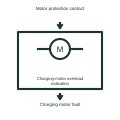

# Charging-motor overload indication

Carries the documented motor protective-device operation into the breaker alarm system.

[Canonical reference](https://eloragrid.ai/symbols/charging-motor-overload-indication) · [Structured record](../entries/charging-motor-overload-indication.json) · [All references](README.md)

Updated: 2026-11-03. Drawing use: Schematic. Reference families: Manufacturer.

Representation: functional-block; installation focus: switchgear.
Motor protection contact
Charging motor fault

## What it represents

Carries the documented motor protective-device operation into the breaker alarm system. A stored-energy breaker mechanism has charging, release, indication and supervision functions. Motor supply, stored spring energy and the ability to complete an opening operation are separate drawing concerns.
In a switchgear panel, a charging motor replenishes the mechanism after an operation. Supervisory contacts let the controller report an incomplete charge or repeated charging demand before an operator requests another operation. For this reference, the drawing identifies “Motor protection contact” at the input and “Charging motor fault” at the output. Protection selection remains manufacturer-specific.
Show the individual contacts and the relevant motor or release circuit. Supply voltage, charging time, operating duty and permissible alarms must follow the chosen mechanism documentation. The functional block is an independent explanation of this named application. Equipment-specific ratings, terminal connections and operating conditions must be established in the project documentation.

## How to read it

- Start at the named input: Motor protection contact. Identify its source device or document and the state represented on the drawing.
- Follow the named output: Charging motor fault. Cross-reference its destination and separate the command from confirmation that the equipment responded.
- Protection selection remains manufacturer-specific.
- Show the individual contacts and the relevant motor or release circuit. Supply voltage, charging time, operating duty and permissible alarms must follow the chosen mechanism documentation.

## Drawing checklist

- Label the source and connection reference for motor protection contact.
- Identify the destination and defined state of charging motor fault.
- Record the equipment or control-document revision supporting this functional block.
- Check this application limit in the project design: Protection selection remains manufacturer-specific.

## Important distinction

Protection selection remains manufacturer-specific. This reference describes the named application; it does not establish a new IEC graphical symbol, an ANSI device-function number or an exact manufacturer connection diagram.

## Facts

- Representation: Functional block
- Installation focus: Switchgear
- Input / boundary: Motor protection contact
- Output / connection: Charging motor fault
- Lookup label: COI is a library lookup label, not a standard device designation.

## Public references

- [Masterclad medium-voltage switchgear: circuit-breaker section interlocks](https://productinfo.se.com/masterclad_mv_switchgear_ib/6055-30-masterclad-15kv-mv-switchgear-ib/English/6055-30%20Masterclad%20MV%20Switchgear%20Indoor%20%28bookmap%29_DD00646805.xml/%24/Section6-CircuitBreakerSectionInter-58DD6EC7) — Schneider Electric. Public technical context for stored-energy mechanism supervision. Breaker control, mechanism, position contacts, racking interlocks and test interfaces. The application text and educational graphic are independently authored; the publisher does not certify this representation.

## Related references

- [Circuit breaker](circuit-breaker.md)
- [Three-phase motor](motor.md)
- [Stored-energy discharged indication](stored-energy-discharged-indication.md)

Original educational concept geometry, CC BY 4.0. Unitless; not a certified standards glyph or manufacturer footprint.

Elora-authored explanations are CC BY 4.0. Linked standards and manufacturer material retain their own rights. Confirm project requirements using primary sources.
