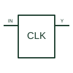

# Clock generator

Provides the documented clock signal or signals used by digital circuitry.

[Canonical reference](https://eloragrid.ai/symbols/clock-generator) · [Structured record](../entries/clock-generator.json) · [All references](README.md)

Updated: 2026-10-27. Drawing use: Schematic. Reference families: Manufacturer.

## What it represents

Provides the documented clock signal or signals used by digital circuitry.
On a schematic, identify the reference oscillator/input, supply and enable/configuration pins and trace the clock outputs and receiving clock domains. Keep the component tag and signal/reference names consistent across the control drawing, terminal schedule and device documentation.
A clock-generator block does not define frequency, jitter or electrical interface without its selected component documentation.
The preview is an independently drawn educational functional reference. Add the selected component’s actual power pins, terminal numbers, timing or analogue reference details when producing a construction drawing.

## How to read it

- Identify the reference oscillator/input, supply and enable/configuration pins.
- Trace the clock outputs and receiving clock domains.

## Drawing checklist

- Label the reference oscillator/input, supply and enable/configuration pins.
- Cross-reference the clock outputs and receiving clock domains.
- Add the selected device or circuit documentation revision, power/reference connections and project signal convention.

## Important distinction

A clock-generator block does not define frequency, jitter or electrical interface without its selected component documentation.

## Facts

- Common schematic mnemonic: CLK-GEN — descriptive only; project/device documentation defines reference designations.
- Terminal / interface focus: The reference oscillator/input, supply and enable/configuration pins
- Artwork scope: Original educational functional/circuit reference; not a selected product pinout.

## Public references

- [CDCE913 — clock-generation interfaces](https://www.ti.com/product/CDCE913) — Texas Instruments. Public primary manufacturer documentation establishes the component function or circuit/topology relationship. Preview geometry and drafting explanations are independently authored.

## Related references

- [Positive-edge D flip-flop](positive-edge-d-flip-flop.md)
- [PLC input / output](plc-io.md)

Original educational concept geometry, CC BY 4.0. Unitless; not a certified standards glyph or manufacturer footprint.

Elora-authored explanations are CC BY 4.0. Linked standards and manufacturer material retain their own rights. Confirm project requirements using primary sources.
