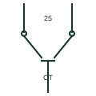

# Closed-transition transfer switch

A transfer switch that briefly parallels two synchronised sources so the load moves without interruption.

[Canonical reference](https://eloragrid.ai/symbols/closed-transition-transfer-switch) · [Structured record](../entries/closed-transition-transfer-switch.json) · [All references](README.md)

Updated: 2026-10-28. Drawing use: SLD. Reference families: IEC, IEEE / ANSI.

## What it represents

A closed-transition transfer switch connects the load to the new source before disconnecting it from the old one, with both sources paralleled for a short time, typically less than 100 milliseconds. A synchronism check confirms that voltage, frequency and phase angle are within limits before the overlap is allowed.
Drawings show two switching devices or a transfer switch with both contacts able to close, plus a synchronism check function and often a note on maximum overlap time. Where the overlap is longer than the network operator allows, a soft-load transfer with a paralleling controller is used instead.
Even a momentary parallel connection can require approval from the network operator and protection against the generator feeding a utility fault. The symbol does not show the overlap timer, its backup trip or the interface protection.

## How to read it

- A synchronism check function should be associated with the switch.
- Read the maximum overlap time permitted.

## Drawing checklist

- State overlap time and synchronising limits.
- Show synchronism check and backup trip.
- Reference network operator approval.

## Important distinction

A closed-transition switch overlaps the two sources; an open-transition switch always breaks before it makes.

## Facts

- Transition: Make before break
- Overlap: Typically under 100 ms
- Required check: Synchronism
- Preview: Independent educational illustration; consult the applicable standard and project legend for the exact graphic

## Public references

- [Transfer switch fundamentals](https://www.cummins.com/sites/default/files/2026-04/2023-sep-transfer-switch-fundamentals.pdf) — Cummins. Public transfer switch fundamentals including transition types.
- [ATS controllers](https://www.deif.com/products/controllers/ats-controller/) — DEIF. Public transfer controller page describing overlap switching.

## Related references

- [Automatic transfer switch](automatic-transfer-switch.md)
- [Synchronism check](25-synchronism-check.md)
- [Transfer-switch assembly](transfer-switch.md)
- [Static transfer switch](static-transfer-switch.md)

Original educational concept geometry, CC BY 4.0. Unitless; not a certified standards glyph or manufacturer footprint.

Elora-authored explanations are CC BY 4.0. Linked standards and manufacturer material retain their own rights. Confirm project requirements using primary sources.
