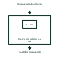

# Closing-coil isolation test link

Marks the removable connection used to separate closing control from the breaker coil.

[Canonical reference](https://eloragrid.ai/symbols/closing-coil-isolation-test-link) · [Structured record](../entries/closing-coil-isolation-test-link.json) · [All references](README.md)

Updated: 2026-11-03. Drawing use: Schematic. Reference families: Manufacturer.

Representation: functional-block; installation focus: switchgear.
Closing output conductor
Isolatable closing path

## What it represents

Marks the removable connection used to separate closing control from the breaker coil. A closing circuit combines an operator or automatic request with the conditions that allow the breaker to close. The closing coil releases stored mechanism energy where that construction is used; it is different from the spring-charging motor.
In a switchgear bus-coupler panel, a close request is checked against position, mechanism readiness and the selected live-bus or dead-bus conditions before the closing circuit is enabled. For this reference, the drawing identifies “Closing output conductor” at the input and “Isolatable closing path” at the output. The link position affects equipment availability.
Follow request, permission and final coil output as separate signals. A permissive diagram must say which conditions block closing and what happens if a feedback signal becomes unavailable. The functional block is an independent explanation of this named application. Equipment-specific ratings, terminal connections and operating conditions must be established in the project documentation.

## How to read it

- Start at the named input: Closing output conductor. Identify its source device or document and the state represented on the drawing.
- Follow the named output: Isolatable closing path. Cross-reference its destination and separate the command from confirmation that the equipment responded.
- The link position affects equipment availability.
- Follow request, permission and final coil output as separate signals. A permissive diagram must say which conditions block closing and what happens if a feedback signal becomes unavailable.

## Drawing checklist

- Label the source and connection reference for closing output conductor.
- Identify the destination and defined state of isolatable closing path.
- Record the equipment or control-document revision supporting this functional block.
- Check this application limit in the project design: The link position affects equipment availability.

## Important distinction

The link position affects equipment availability. This reference describes the named application; it does not establish a new IEC graphical symbol, an ANSI device-function number or an exact manufacturer connection diagram.

## Facts

- Representation: Functional block
- Installation focus: Switchgear
- Input / boundary: Closing output conductor
- Output / connection: Isolatable closing path
- Lookup label: CITL is a library lookup label, not a standard device designation.

## Public references

- [Masterclad medium-voltage switchgear: circuit-breaker section interlocks](https://productinfo.se.com/masterclad_mv_switchgear_ib/6055-30-masterclad-15kv-mv-switchgear-ib/English/6055-30%20Masterclad%20MV%20Switchgear%20Indoor%20%28bookmap%29_DD00646805.xml/%24/Section6-CircuitBreakerSectionInter-58DD6EC7) — Schneider Electric. Public technical context for breaker closing controls. Breaker control, mechanism, position contacts, racking interlocks and test interfaces. The application text and educational graphic are independently authored; the publisher does not certify this representation.

## Related references

- [Circuit breaker](circuit-breaker.md)
- [Synchronism check](25-synchronism-check.md)
- [Breaker close-failure timer](breaker-close-failure-timer.md)

Original educational concept geometry, CC BY 4.0. Unitless; not a certified standards glyph or manufacturer footprint.

Elora-authored explanations are CC BY 4.0. Linked standards and manufacturer material retain their own rights. Confirm project requirements using primary sources.
