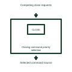

# Closing-command priority selection

Resolves simultaneous local and remote closing requests using the defined control authority.

[Canonical reference](https://eloragrid.ai/symbols/closing-command-priority-selection) · [Structured record](../entries/closing-command-priority-selection.json) · [All references](README.md)

Updated: 2026-11-03. Drawing use: Schematic. Reference families: Manufacturer.

Representation: functional-block; installation focus: switchgear.
Competing close requests
Selected command source

## What it represents

Resolves simultaneous local and remote closing requests using the defined control authority. A closing circuit combines an operator or automatic request with the conditions that allow the breaker to close. The closing coil releases stored mechanism energy where that construction is used; it is different from the spring-charging motor.
In a switchgear bus-coupler panel, a close request is checked against position, mechanism readiness and the selected live-bus or dead-bus conditions before the closing circuit is enabled. For this reference, the drawing identifies “Competing close requests” at the input and “Selected command source” at the output. Priority must follow the project control philosophy.
Follow request, permission and final coil output as separate signals. A permissive diagram must say which conditions block closing and what happens if a feedback signal becomes unavailable. The functional block is an independent explanation of this named application. Equipment-specific ratings, terminal connections and operating conditions must be established in the project documentation.

## How to read it

- Start at the named input: Competing close requests. Identify its source device or document and the state represented on the drawing.
- Follow the named output: Selected command source. Cross-reference its destination and separate the command from confirmation that the equipment responded.
- Priority must follow the project control philosophy.
- Follow request, permission and final coil output as separate signals. A permissive diagram must say which conditions block closing and what happens if a feedback signal becomes unavailable.

## Drawing checklist

- Label the source and connection reference for competing close requests.
- Identify the destination and defined state of selected command source.
- Record the equipment or control-document revision supporting this functional block.
- Check this application limit in the project design: Priority must follow the project control philosophy.

## Important distinction

Priority must follow the project control philosophy. This reference describes the named application; it does not establish a new IEC graphical symbol, an ANSI device-function number or an exact manufacturer connection diagram.

## Facts

- Representation: Functional block
- Installation focus: Switchgear
- Input / boundary: Competing close requests
- Output / connection: Selected command source
- Lookup label: CPS is a library lookup label, not a standard device designation.

## Public references

- [Masterclad medium-voltage switchgear: circuit-breaker section interlocks](https://productinfo.se.com/masterclad_mv_switchgear_ib/6055-30-masterclad-15kv-mv-switchgear-ib/English/6055-30%20Masterclad%20MV%20Switchgear%20Indoor%20%28bookmap%29_DD00646805.xml/%24/Section6-CircuitBreakerSectionInter-58DD6EC7) — Schneider Electric. Public technical context for breaker closing controls. Breaker control, mechanism, position contacts, racking interlocks and test interfaces. The application text and educational graphic are independently authored; the publisher does not certify this representation.

## Related references

- [Circuit breaker](circuit-breaker.md)
- [Synchronism check](25-synchronism-check.md)
- [Dead-bus close permission](dead-bus-close-permission.md)

Original educational concept geometry, CC BY 4.0. Unitless; not a certified standards glyph or manufacturer footprint.

Elora-authored explanations are CC BY 4.0. Linked standards and manufacturer material retain their own rights. Confirm project requirements using primary sources.
