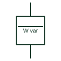

# Combined recording wattmeter and varmeter

Recording instrument that logs active and reactive power together from shared current and voltage inputs.

[Canonical reference](https://eloragrid.ai/symbols/combined-recording-wattmeter-varmeter) · [Structured record](../entries/combined-recording-wattmeter-varmeter.json) · [All references](README.md)

Updated: 2026-10-28. Drawing use: SLD, Schematic. Reference families: IEC.

## What it represents

This form represents one recording instrument that logs both active power and reactive power on the same time base. It is drawn at generator and interconnection points where the relationship between watts and vars matters, for example when checking excitation control or reactive power commitments.
Both quantities come from the same CT and VT inputs, so the symbol should show those connections once. It does not define the sign convention for import, export, leading or lagging vars, which must be stated so records can be interpreted correctly.

## How to read it

- Check sign conventions for both quantities.
- Confirm both channels share the same CT and VT inputs.

## Drawing checklist

- Show CT and VT ratios
- Define sign conventions
- State recording interval

## Important distinction

The combined recorder logs watts and vars together; a recording wattmeter logs active power only.

## Facts

- Recorded quantities: Active and reactive power
- Typical location: Generator or interconnection point
- Preview: Independent educational concept; consult the applicable standard and project legend for the exact graphic

## Public references

- [IEC graphical symbols for diagrams](https://tc3.iec.ch/tc-activity/graphical-symbols-for-diagrams/) — IEC. IEC context for graphical symbols used in diagrams; no IEC graphic is reproduced.
- [Power and energy measurement quantities](https://www.se.com/ph/en/faqs/FA343278/) — Schneider Electric. Public explanation of active and reactive power quantities.

## Related references

- [Recording wattmeter](recording-wattmeter.md)
- [Reactive-power meter](reactive-power-meter.md)
- [Recording instrument general symbol](recording-instrument-general-symbol.md)

Original educational concept geometry, CC BY 4.0. Unitless; not a certified standards glyph or manufacturer footprint.

Elora-authored explanations are CC BY 4.0. Linked standards and manufacturer material retain their own rights. Confirm project requirements using primary sources.
