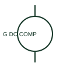

# Compound-excited DC generator

A compound-excited DC generator uses documented series and shunt excitation components.

[Canonical reference](https://eloragrid.ai/symbols/compound-excited-dc-generator) · [Structured record](../entries/compound-excited-dc-generator.json) · [All references](README.md)

Updated: 2026-10-27. Drawing use: SLD, Schematic. Reference families: IEC, Manufacturer.

## What it represents

A compound-excited DC generator uses documented series and shunt excitation components. The drawing must identify their connections rather than relying on a generic generator circle.

## How to read it

- Trace each field winding relative to the armature and output circuit.
- The preview is an original explanation of this function. Match the actual drawing convention to its legend and the selected equipment documentation.

## Drawing checklist

- Show both field components
- Identify output polarity
- Reference excitation connection

## Important distinction

Compound excitation combines field arrangements; it is different from a permanent-magnet generator.

## Facts

- Drawing role: Generating source
- Representation scope: Functional concept; not an official standard graphic or a product footprint
- Public vendor block reference: HPW1G10, VPW1G10 (Autodesk identifiers; not IEC symbol numbers)
- Identifier status: The short label is a functional lookup label, not an assigned IEC or IEEE symbol number. Any separately listed Autodesk code is a verified vendor block name.

## Public references

- [Generator symbol variants](https://help.autodesk.com/cloudhelp/2021/ENU/AutoCAD-Electrical/files/GUID-09BE3BB5-9118-4302-8061-3888692E538F.htm) — Autodesk. Public documentation of this equipment function or named vendor variant; the illustration is independently authored and is not the source graphic.

## Related references

- [Generator](generator.md)
- [Synchronism check](25-synchronism-check.md)

Original educational concept geometry, CC BY 4.0. Unitless; not a certified standards glyph or manufacturer footprint.

Elora-authored explanations are CC BY 4.0. Linked standards and manufacturer material retain their own rights. Confirm project requirements using primary sources.
