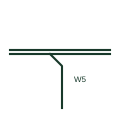

# Conductor branching from a group

One conductor drawn leaving a single-line conductor group at an angle, showing where it splits from the bundle.

[Canonical reference](https://eloragrid.ai/symbols/conductor-branch-from-group) · [Structured record](../entries/conductor-branch-from-group.json) · [All references](README.md)

Updated: 2026-10-28. Drawing use: Schematic. Reference families: IEC, IEEE / ANSI.

## What it represents

When conductors are drawn as a single line or bundle, a breakout shows the point where one conductor leaves the group to go elsewhere. The leaving conductor is normally drawn at an angle or with a short curve and carries its own identifier, so that the group line beyond the breakout has one less conductor.
The breakout is a drawing convention, not a physical joint. No splice or terminal exists at the point unless a separate symbol is placed there. Readers should track the conductor count on each side of the breakout and confirm the identifiers match on both.

## How to read it

- Track conductor count either side of the breakout.
- Do not read the breakout as a splice.

## Drawing checklist

- Label the conductor that leaves the group.
- Update the count on the remaining group line.
- Add a splice symbol only where a physical joint exists.

## Important distinction

A breakout is a drawing convention for a conductor leaving a bundle; a wire splice is a physical joint.

## Facts

- Graphic cue: Angled conductor leaving a thicker group line
- Physical meaning: None; drawing convention only
- Preview: Original educational illustration; consult the publisher and applicable standard for the exact graphic

## Public references

- [Wire connection dots, crossing gaps and loops](https://help.autodesk.com/cloudhelp/2020/ENU/AutoCAD-Electrical/files/GUID-936BB8A9-9C01-4AC6-B833-CB97700A7203.htm) — Autodesk. Public guidance on wire connection display in drawings.
- [IEC-60617 symbol preview directory](https://help.autodesk.com/cloudhelp/2021/ENU/AutoCAD-Electrical/files/GUID-7871E6EF-24D5-467E-9B74-321FEDC9DFDA.htm) — Autodesk. Public directory of IEC-oriented symbol families.

## Related references

- [Wire splice](wire-splice.md)
- [Conductor connection junction](iec-conductor-connection-junction.md)
- [Conductor count by numeral](conductor-count-numeral.md)

Original educational concept geometry, CC BY 4.0. Unitless; not a certified standards glyph or manufacturer footprint.

Elora-authored explanations are CC BY 4.0. Linked standards and manufacturer material retain their own rights. Confirm project requirements using primary sources.
