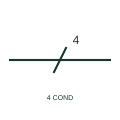

# Conductor count by numeral

A single oblique stroke across a line with a number beside it, stating how many conductors the single line represents.

[Canonical reference](https://eloragrid.ai/symbols/conductor-count-numeral) · [Structured record](../entries/conductor-count-numeral.json) · [All references](README.md)

Updated: 2026-10-28. Drawing use: SLD, Schematic. Reference families: IEC, IEEE / ANSI.

## What it represents

Where a single line stands for several conductors, the count can be shown by one oblique stroke plus a numeral rather than by repeating strokes. This is the practical form for larger counts, such as a 12 core control cable or a 4 conductor feeder, where drawing many strokes would be cluttered.
The numeral counts conductors, not circuits or phases. A value of 4 might be three phases and neutral, or four control cores, and the drawing must say which. It also does not state conductor size. On plan drawings the count is often combined with a size, for example 4 x 16 mm2, which belongs in the annotation rather than the stroke.

## How to read it

- Confirm what conductors are included in the count, for example phases, neutral and PE.
- Read the size annotation separately from the count.

## Drawing checklist

- Place the numeral next to the stroke, not on another line.
- Say what the conductors are where it is not obvious.
- Keep conductor size in the cable annotation.

## Important distinction

A numeral count gives any number of conductors on one stroke; the three-phase conductor group uses three strokes specifically for three conductors.

## Facts

- Graphic cue: One oblique stroke across the line with a number beside it
- Counts: Conductors, not circuits
- Preview: Original educational illustration; consult the publisher and applicable standard for the exact graphic

## Public references

- [IEC-60617 symbol preview directory](https://help.autodesk.com/cloudhelp/2021/ENU/AutoCAD-Electrical/files/GUID-7871E6EF-24D5-467E-9B74-321FEDC9DFDA.htm) — Autodesk. Public directory of IEC-oriented symbol families.
- [IEEE/ANSI 315-1975: graphic symbols for electrical and electronics diagrams](https://standards.ieee.org/ieee/315/515/) — IEEE Standards Association. Standards context for conductor-count conventions in IEEE graphics.

## Related references

- [Three-phase conductor group](iec-three-phase-conductor-group.md)
- [Three-phase circuit with neutral and PE marking](iec-three-phase-five-wire-marking.md)
- [One-line cable identification](iec-one-line-cable-identification.md)

Original educational concept geometry, CC BY 4.0. Unitless; not a certified standards glyph or manufacturer footprint.

Elora-authored explanations are CC BY 4.0. Linked standards and manufacturer material retain their own rights. Confirm project requirements using primary sources.
