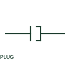

# Connector plug half

A plug-half representation identifies one side of a detachable connector.

[Canonical reference](https://eloragrid.ai/symbols/connector-plug-half) · [Structured record](../entries/connector-plug-half.json) · [All references](README.md)

Updated: 2026-10-27. Drawing use: Schematic. Reference families: IEC, Manufacturer.

## What it represents

A plug-half representation identifies one side of a detachable connector. Its mating reference and pin number preserve the circuit path when the other half appears elsewhere.

## How to read it

- Locate the mating socket before treating the endpoint as an unconnected conductor.
- The preview is an original explanation of this function. Match the actual drawing convention to its legend and the selected equipment documentation.

## Drawing checklist

- Identify connector tag
- State pin number
- Cross-reference mating half

## Important distinction

A separately drawn plug is not a terminal block or an off-sheet wire arrow.

## Facts

- Drawing role: Detachable connection
- Representation scope: Functional concept; not an official standard graphic or a product footprint
- Public vendor block reference: HC01P\_, VC01P\_ (Autodesk identifiers; not IEC symbol numbers)
- Identifier status: The short label is a functional lookup label, not an assigned IEC or IEEE symbol number. Any separately listed Autodesk code is a verified vendor block name.

## Public references

- [AutoCAD Electrical: Connectors](https://help.autodesk.com/cloudhelp/2021/ENU/AutoCAD-Electrical/files/GUID-7175D293-9F4C-485C-8E2D-DE684820D53B.htm) — Autodesk. Public documentation of this equipment function or named vendor variant; the illustration is independently authored and is not the source graphic.

## Related references

- [Terminal connection](terminal.md)
- [PLC input / output](plc-io.md)

Original educational concept geometry, CC BY 4.0. Unitless; not a certified standards glyph or manufacturer footprint.

Elora-authored explanations are CC BY 4.0. Linked standards and manufacturer material retain their own rights. Confirm project requirements using primary sources.
