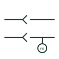

# Connector with protective earth contact

A plug and socket in which one contact is the protective earth, usually making first and breaking last.

[Canonical reference](https://eloragrid.ai/symbols/connector-with-protective-earth-contact) · [Structured record](../entries/connector-with-protective-earth-contact.json) · [All references](README.md)

Updated: 2026-10-28. Drawing use: Schematic. Reference families: IEC, IEEE / ANSI.

## What it represents

This form identifies a connector where one contact carries the protective conductor. The earth contact is normally longer so it makes before and breaks after the live contacts, keeping the connected equipment earthed whenever it could be energised. The earth pin is drawn with a protective earth mark or PE label.
The symbol does not prove the first-make, last-break feature exists in the selected product, so the connector type must be checked. Where a connector carries power and signals, the earth pin also often serves as the reference for screens, which should be drawn explicitly.

## How to read it

- Identify the PE contact and check it is first-make, last-break.
- Check that the PE pin is not used as a signal return.

## Drawing checklist

- Label the PE contact clearly.
- Specify a connector with leading earth contact.
- Keep PE continuity through both connector halves.

## Important distinction

A connector PE contact carries the protective conductor through a separable joint; a protective earth terminal is a fixed connection point.

## Facts

- Graphic cue: Plug and socket pair with one contact marked PE
- Contact sequence: Earth makes first and breaks last
- Preview: Original educational illustration; consult the publisher and applicable standard for the exact graphic

## Public references

- [AutoCAD Electrical: Connectors](https://help.autodesk.com/cloudhelp/2021/ENU/AutoCAD-Electrical/files/GUID-7175D293-9F4C-485C-8E2D-DE684820D53B.htm) — Autodesk. Public IEC-oriented preview of plug and jack connector forms.
- [AutoCAD Electrical: Earthing, sources and surge protection](https://help.autodesk.com/cloudhelp/2021/ENU/AutoCAD-Electrical/files/GUID-1E3FDEAE-B4B2-417C-8075-108AA2C6E509.htm) — Autodesk. Public IEC-oriented protective earth form.

## Related references

- [Protective earth](protective-earth.md)
- [Multi-pole plug and socket](iec-multi-pole-plug-and-socket.md)
- [Protective-earth terminal block](protective-earth-terminal-block.md)

Original educational concept geometry, CC BY 4.0. Unitless; not a certified standards glyph or manufacturer footprint.

Elora-authored explanations are CC BY 4.0. Linked standards and manufacturer material retain their own rights. Confirm project requirements using primary sources.
