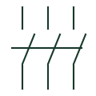

# Contactor

An electrically operated switching device commonly used for repeated switching duties.

[Canonical reference](https://eloragrid.ai/symbols/contactor) · [Structured record](../entries/contactor.json) · [All references](README.md)

Updated: 2026-10-27. Drawing use: SLD, Schematic. Reference families: IEC, IEEE / ANSI.

## What it represents

A contactor uses an operating mechanism to switch its main contacts and may include auxiliary contacts for control or indication. On a power drawing it represents the main switching path; on a schematic its coil and contacts may be distributed and connected by identifiers.
Its ability to switch a particular load depends on the selected device and utilization category. Overload or short-circuit protection can be provided by other devices in the arrangement. Do not treat the generic contactor representation as a complete protective device.

## How to read it

- Distinguish main power poles from auxiliary control contacts.
- Use the common equipment identifier to connect the power and control drawings.

## Drawing checklist

- Reference the load duty and contactor specification.
- Show the coil supply and associated contacts.
- Identify separate protective equipment where applicable.

## Important distinction

A contactor and circuit breaker have different duties. Adding an overload relay does not make every contactor assembly equivalent to a circuit breaker.

## Facts

- Main role: Repeated electrical switching
- Tag example: KM is a convention, not a universal requirement
- Protection: Confirm the complete arrangement

## Public references

- [Elementary switching devices](https://www.electrical-installation.org/enwiki/Elementary_switching_devices) — Schneider Electric — Electrical Installation Guide. Manufacturer description of contactors and associated protection.
- [Relays and contacts: public symbol reference](https://help.autodesk.com/cloudhelp/2021/ENU/AutoCAD-Electrical/files/GUID-011C62B8-9EC8-485C-B47D-B22A3F7B7574.htm) — Autodesk. Public operating-coil and contact representations.

## Related references

- [Relay coil](relay-coil.md)
- [Three-phase motor](motor.md)
- [Circuit breaker](circuit-breaker.md)
- [Normally open contact](normally-open-contact.md)

Original educational concept geometry, CC BY 4.0. Unitless; not a certified standards glyph or manufacturer footprint.

Elora-authored explanations are CC BY 4.0. Linked standards and manufacturer material retain their own rights. Confirm project requirements using primary sources.
