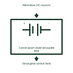

# Control-power diode-decoupled feed

Combines permitted source paths through the documented unidirectional decoupling devices.

[Canonical reference](https://eloragrid.ai/symbols/control-power-diode-decoupled-feed) · [Structured record](../entries/control-power-diode-decoupled-feed.json) · [All references](README.md)

Updated: 2026-11-03. Drawing use: Schematic. Reference families: Manufacturer.

Representation: functional-block; installation focus: switchgear.
Alternative DC sources
Decoupled control feed

## What it represents

Combines permitted source paths through the documented unidirectional decoupling devices. Control power supplies the command, protection and indication equipment associated with a switchgear assembly. The drawing must distinguish the source, each distribution branch and the functions lost if that branch fails.
In a switchgear lineup, separate protected branches may feed trip coils, closing coils and protection electronics. Their alarm contacts help the station controller identify which operating capability is unavailable. For this reference, the drawing identifies “Alternative DC sources” at the input and “Decoupled control feed” at the output. Diode voltage drop affects available operating voltage.
Follow the actual positive, negative or neutral returns and the protective device on each branch. A healthy voltage indication does not establish that every downstream path can deliver its required operating current. The functional block is an independent explanation of this named application. Equipment-specific ratings, terminal connections and operating conditions must be established in the project documentation.

## How to read it

- Start at the named input: Alternative DC sources. Identify its source device or document and the state represented on the drawing.
- Follow the named output: Decoupled control feed. Cross-reference its destination and separate the command from confirmation that the equipment responded.
- Diode voltage drop affects available operating voltage.
- Follow the actual positive, negative or neutral returns and the protective device on each branch. A healthy voltage indication does not establish that every downstream path can deliver its required operating current.

## Drawing checklist

- Label the source and connection reference for alternative dc sources.
- Identify the destination and defined state of decoupled control feed.
- Record the equipment or control-document revision supporting this functional block.
- Check this application limit in the project design: Diode voltage drop affects available operating voltage.

## Important distinction

Diode voltage drop affects available operating voltage. This reference describes the named application; it does not establish a new IEC graphical symbol, an ANSI device-function number or an exact manufacturer connection diagram.

## Facts

- Representation: Functional block
- Installation focus: Switchgear
- Input / boundary: Alternative DC sources
- Output / connection: Decoupled control feed
- Lookup label: CDF is a library lookup label, not a standard device designation.

## Public references

- [SEL-RPM redundant power module](https://selinc.com/products/RPM/) — SEL. Public technical context for switchgear control-power supervision. Independent AC and DC sources for station auxiliary power. The application text and educational graphic are independently authored; the publisher does not certify this representation.

## Related references

- [Relay coil](relay-coil.md)
- [AC-to-DC power supply](ac-to-dc-power-supply.md)
- [Control-power automatic source selection](control-power-automatic-source-selection.md)

Original educational concept geometry, CC BY 4.0. Unitless; not a certified standards glyph or manufacturer footprint.

Elora-authored explanations are CC BY 4.0. Linked standards and manufacturer material retain their own rights. Confirm project requirements using primary sources.
