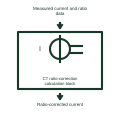

# CT ratio-correction calculation block

Converts a measured current quantity to the common basis used by the selected protection calculation.

[Canonical reference](https://eloragrid.ai/symbols/ct-ratio-correction-calculation-block) · [Structured record](../entries/ct-ratio-correction-calculation-block.json) · [All references](README.md)

Updated: 2026-11-03. Drawing use: Schematic. Reference families: Manufacturer.

Representation: functional-block; installation focus: substations.
Measured current and ratio data
Ratio-corrected current

## What it represents

Converts a measured current quantity to the common basis used by the selected protection calculation. A current-transformer secondary arrangement carries a measuring current from a defined primary location to metering or protection inputs. Core identity, polarity and the connected circuit determine the measurement's meaning.
In a substation protection panel, separate CT cores can supply metering and protection circuits with different duties. A test boundary must preserve the secondary arrangement required by the selected CT and test device. For this reference, the drawing identifies “Measured current and ratio data” at the input and “Ratio-corrected current” at the output. Software correction does not change the physical CT ratio.
Trace every secondary connection and the assigned earthing point against the actual connection diagram. These illustrations explain circuit roles and never prescribe a live CT switching or disconnection procedure. The functional block is an independent explanation of this named application. Equipment-specific ratings, terminal connections and operating conditions must be established in the project documentation.

## How to read it

- Start at the named input: Measured current and ratio data. Identify its source device or document and the state represented on the drawing.
- Follow the named output: Ratio-corrected current. Cross-reference its destination and separate the command from confirmation that the equipment responded.
- Software correction does not change the physical CT ratio.
- Trace every secondary connection and the assigned earthing point against the actual connection diagram. These illustrations explain circuit roles and never prescribe a live CT switching or disconnection procedure.

## Drawing checklist

- Label the source and connection reference for measured current and ratio data.
- Identify the destination and defined state of ratio-corrected current.
- Record the equipment or control-document revision supporting this functional block.
- Check this application limit in the project design: Software correction does not change the physical CT ratio.

## Important distinction

Software correction does not change the physical CT ratio. This reference describes the named application; it does not establish a new IEC graphical symbol, an ANSI device-function number or an exact manufacturer connection diagram.

## Facts

- Representation: Functional block
- Installation focus: Substations
- Input / boundary: Measured current and ratio data
- Output / connection: Ratio-corrected current
- Lookup label: CRCB is a library lookup label, not a standard device designation.

## Public references

- [Indoor current and voltage transformers](https://www.abb.com/gb/en/areas/electrification/medium-voltage/grid-components/core-components/indoor-instrument-transformers) — ABB. Public technical context for current-transformer secondary arrangements. Current and voltage measurement transformers and their secondary interfaces. The application text and educational graphic are independently authored; the publisher does not certify this representation.

## Related references

- [Current transformer](current-transformer.md)
- [CT test terminal](ct-test-terminal.md)
- [CT secondary burden allocation reference](ct-secondary-burden-allocation-reference.md)

Original educational concept geometry, CC BY 4.0. Unitless; not a certified standards glyph or manufacturer footprint.

Elora-authored explanations are CC BY 4.0. Linked standards and manufacturer material retain their own rights. Confirm project requirements using primary sources.
