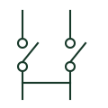

# CT test terminal

A current-transformer terminal arrangement providing documented test and shorting facilities.

[Canonical reference](https://eloragrid.ai/symbols/ct-test-terminal) · [Structured record](../entries/ct-test-terminal.json) · [All references](README.md)

Updated: 2026-10-27. Drawing use: Schematic. Reference families: IEC, IEEE / ANSI.

## What it represents

A CT test-terminal arrangement connects current-transformer secondary wiring to measurement or protection equipment and provides the test or short-circuit facilities specified for the selected assembly. Its representation must be read with the manufacturer circuit and operating documentation.
Test-disconnect terminals are not all interchangeable. CT applications require the correct shorting behaviour and accessory arrangement. This reference explains what to identify in a drawing, not a procedure for disconnecting or working on a live CT circuit.

## How to read it

- Identify each CT secondary path and the associated test or shorting connections.
- Do not infer the operation of a test plug or link from a generic terminal mark.

## Drawing checklist

- Reference the exact terminal assembly.
- Identify shorting links and test accessories.
- Cross-reference the CT and connected measurement device.

## Important distinction

A generic disconnect terminal is not automatically suitable for a CT secondary circuit. Use an arrangement specified for the CT application.

## Facts

- Application: CT secondary measuring and test circuit
- Shorting behaviour: Specific to selected assembly
- Operating procedure: Follow manufacturer and authorised work instructions

## Public references

- [Transformer terminals for measuring and test circuits](https://www.phoenixcontact.com/en-ie/products/terminal-blocks/transformer-terminal-blocks?p=7) — Phoenix Contact. Manufacturer CT measuring, testing and leading-short-circuit terminal arrangements.
- [Disconnect and knife-disconnect terminal blocks](https://www.phoenixcontact.com/en-au/products/terminal-blocks/disconnect-and-knife-disconnect-terminal-blocks) — Phoenix Contact. Contrast with generic disconnect-terminal products.

## Related references

- [Current transformer](current-transformer.md)
- [Terminal connection](terminal.md)
- [Terminal strip assembly](terminal-strip.md)
- [Instantaneous overcurrent](50-instantaneous-overcurrent.md)

Original educational concept geometry, CC BY 4.0. Unitless; not a certified standards glyph or manufacturer footprint.

Elora-authored explanations are CC BY 4.0. Linked standards and manufacturer material retain their own rights. Confirm project requirements using primary sources.
