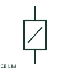

# Current-limiting circuit breaker

A current-limiting breaker reduces the fault-current peak and energy passed to downstream equipment within its documented operating range.

[Canonical reference](https://eloragrid.ai/symbols/current-limiting-circuit-breaker) · [Structured record](../entries/current-limiting-circuit-breaker.json) · [All references](README.md)

Updated: 2026-10-27. Drawing use: SLD, Schematic. Reference families: IEC, Manufacturer.

## What it represents

A current-limiting breaker reduces the fault-current peak and energy passed to downstream equipment within its documented operating range. The drawing tag identifies the characteristic, while coordination data belongs in the design documentation.

## How to read it

- Use manufacturer let-through curves for the applicable prospective fault level.
- The preview is an original explanation of this function. Match the actual drawing convention to its legend and the selected equipment documentation.

## Drawing checklist

- Identify limiting device model
- Reference let-through data
- Document coordination assumptions

## Important distinction

Current limitation is a fault-interruption characteristic, not a continuously regulated load-current function.

## Facts

- Drawing role: Circuit interruption
- Representation scope: Functional concept; not an official standard graphic or a product footprint
- Public vendor block reference: HCB11THI, VCB11THI (Autodesk identifiers; not IEC symbol numbers)
- Identifier status: The short label is a functional lookup label, not an assigned IEC or IEEE symbol number. Any separately listed Autodesk code is a verified vendor block name.

## Public references

- [Circuit-breaker symbol variants](https://help.autodesk.com/cloudhelp/2021/ENU/AutoCAD-Electrical/files/GUID-DB1548A3-A4D3-47E5-86AC-37000DC57D80.htm) — Autodesk. Public documentation of this equipment function or named vendor variant; the illustration is independently authored and is not the source graphic.
- [Fundamental characteristics of a circuit-breaker](https://www.electrical-installation.org/enwiki/Fundamental_characteristics_of_a_circuit-breaker) — Schneider Electric — Electrical Installation Guide. Public documentation of this equipment function or named vendor variant; the illustration is independently authored and is not the source graphic.

## Related references

- [Circuit breaker](circuit-breaker.md)
- [AC circuit breaker](52-ac-circuit-breaker.md)

Original educational concept geometry, CC BY 4.0. Unitless; not a certified standards glyph or manufacturer footprint.

Elora-authored explanations are CC BY 4.0. Linked standards and manufacturer material retain their own rights. Confirm project requirements using primary sources.
