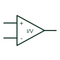

# Current-sense amplifier

Amplifies a voltage associated with a current-sensing shunt using the selected measurement-input arrangement.

[Canonical reference](https://eloragrid.ai/symbols/current-sense-amplifier) · [Structured record](../entries/current-sense-amplifier.json) · [All references](README.md)

Updated: 2026-10-27. Drawing use: Schematic. Reference families: Manufacturer.

## What it represents

Amplifies a voltage associated with a current-sensing shunt using the selected measurement-input arrangement.
On a schematic, identify the shunt polarity, input common-mode reference and gain definition and trace the current-related output and ADC or protection circuit. Keep the component tag and signal/reference names consistent across the control drawing, terminal schedule and device documentation.
A current-sense amplifier measures a shunt voltage; it does not replace the shunt or establish an isolated current-transformer connection.
Terminal letters describe electrical roles, not package pin numbers. Check the selected public datasheet for the actual pin assignment, polarity and any internally connected terminals before completing the drawing.

## How to read it

- Identify the shunt polarity, input common-mode reference and gain definition.
- Trace the current-related output and ADC or protection circuit.

## Drawing checklist

- Label the shunt polarity, input common-mode reference and gain definition.
- Cross-reference the current-related output and ADC or protection circuit.
- Add the selected device or circuit documentation revision, power/reference connections and project signal convention.

## Important distinction

A current-sense amplifier measures a shunt voltage; it does not replace the shunt or establish an isolated current-transformer connection.

## Facts

- Common schematic mnemonic: CSA — descriptive only; project/device documentation defines reference designations.
- Terminal / interface focus: The shunt polarity, input common-mode reference and gain definition
- Artwork scope: Original educational component glyph; not a certified standard graphic or package pinout.

## Public references

- [AD8418 — shunt-current sensing](https://www.analog.com/en/products/ad8418.html) — Analog Devices. Public primary manufacturer documentation establishes the component function or circuit/topology relationship. Preview geometry and drafting explanations are independently authored.

## Related references

- [Current-measuring shunt](current-measuring-shunt.md)
- [PLC input / output](plc-io.md)

Original educational concept geometry, CC BY 4.0. Unitless; not a certified standards glyph or manufacturer footprint.

Elora-authored explanations are CC BY 4.0. Linked standards and manufacturer material retain their own rights. Confirm project requirements using primary sources.
