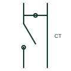

# Current test switch with shorting contact

Panel test switch for CT circuits that shorts the CT side before opening the relay side, with a test jack between.

[Canonical reference](https://eloragrid.ai/symbols/current-test-switch-with-shorting) · [Structured record](../entries/current-test-switch-with-shorting.json) · [All references](README.md)

Updated: 2026-10-28. Drawing use: Schematic. Reference families: IEEE / ANSI, Manufacturer.

## What it represents

Panel-mounted test switches used in North American practice often combine a knife switch with a shorting contact for each CT circuit. Opening the switch first shorts the CT secondary and then isolates the relay or meter, so a test set can be connected without exposing the CT to an open circuit.
Current test switches are usually grouped with potential test switches and trip-isolating switches on one assembly. The symbol shows a single pole, and the full assembly arrangement, including which poles are current and which are potential, must be read from the panel wiring diagram.

## How to read it

- Confirm the shorting contact is on the CT side.
- Read the switch sequence for the assembly.

## Drawing checklist

- Show shorting contact
- Identify CT and relay sides
- Reference assembly pole list

## Important distinction

A current test switch shorts the CT on opening; a potential test switch simply opens the voltage circuit.

## Facts

- Sequence: Short CT, then open relay side
- Common mounting: Front of relay or meter panel
- Preview: Functional illustration of the device role; not a product footprint or certified standard graphic

## Public references

- [Transformer terminals for measuring and test circuits](https://www.phoenixcontact.com/en-ie/products/terminal-blocks/transformer-terminal-blocks?p=7) — Phoenix Contact. Public manufacturer range of transformer and test terminals for measuring and protection circuits.
- [IEEE/ANSI 315-1975: graphic symbols for electrical and electronics diagrams](https://standards.ieee.org/ieee/315/515/) — IEEE Standards Association. IEEE graphic-symbol standards context; no standard glyph is reproduced.

## Related references

- [Potential test switch](potential-test-switch.md)
- [Relay test block](relay-test-block.md)
- [CT test terminal](ct-test-terminal.md)

Original educational concept geometry, CC BY 4.0. Unitless; not a certified standards glyph or manufacturer footprint.

Elora-authored explanations are CC BY 4.0. Linked standards and manufacturer material retain their own rights. Confirm project requirements using primary sources.
