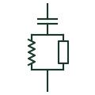

# Damped high-pass harmonic filter

A shunt filter with a resistor across its reactor, giving low impedance over a broad band of higher harmonics.

[Canonical reference](https://eloragrid.ai/symbols/damped-high-pass-harmonic-filter) · [Structured record](../entries/damped-high-pass-harmonic-filter.json) · [All references](README.md)

Updated: 2026-10-28. Drawing use: SLD, Schematic. Reference families: IEC, IEEE / ANSI.

## What it represents

A damped high-pass filter adds a resistor in parallel with the reactor of a capacitor-reactor branch. Above its corner frequency the filter impedance stays low across a wide band, so it absorbs higher-order harmonics and damps resonances rather than sinking one specific order. The C-type variant adds a second capacitor to remove fundamental-frequency losses in the resistor.
Drawings show the capacitor in series with a reactor that has a resistor in parallel, sometimes with the extra capacitor of the C-type arrangement in series with the reactor. It is used beside tuned filters in static var compensators, large rectifier plants and some converter connection points.
The resistor dissipates real power, so its thermal rating is as important as the electrical values. The symbol does not show the corner frequency or the loss figure, which come from the filter design report.

## How to read it

- A resistor across the reactor marks a damped filter.
- An extra series capacitor indicates a C-type arrangement.

## Drawing checklist

- State corner frequency, Mvar and resistor rating.
- Show resistor and capacitor arrangement.
- Reference filter design report.

## Important distinction

A damped high-pass filter covers a band of harmonics; a single-tuned filter sinks one order and has no resistor branch.

## Facts

- Elements: Capacitor, reactor, parallel resistor
- Response: Broad band above corner frequency
- Losses: Dissipated in resistor
- Preview: Independent educational illustration; consult the applicable standard and project legend for the exact graphic

## Public references

- [Capacitor and filter product offerings](https://www.hitachienergy.com/products-and-solutions/capacitors-and-filters) — Hitachi Energy. Public passive and harmonic filter product context.
- [Resistors and heater-element symbols](https://help.autodesk.com/cloudhelp/2021/ENU/AutoCAD-Electrical/files/GUID-1D071951-D38E-4B15-8B9E-C30ECBD55C19.htm) — Autodesk. Public resistor symbol family context.

## Related references

- [Single-tuned harmonic filter](single-tuned-harmonic-filter.md)
- [Static var compensator](static-var-compensator.md)
- [Resistor](resistor.md)
- [Reactor](reactor.md)

Original educational concept geometry, CC BY 4.0. Unitless; not a certified standards glyph or manufacturer footprint.

Elora-authored explanations are CC BY 4.0. Linked standards and manufacturer material retain their own rights. Confirm project requirements using primary sources.
