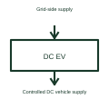

# DC electric vehicle charging station

A DC charging station performs offboard power conversion and supplies controlled DC to the vehicle interface.

[Canonical reference](https://eloragrid.ai/symbols/dc-ev-charging-station) · [Structured record](../entries/dc-ev-charging-station.json) · [All references](README.md)

Updated: 2026-10-27. Drawing use: Schematic. Reference families: Manufacturer.

## What it represents

A DC charging station performs offboard power conversion and supplies controlled DC to the vehicle interface.
The station coordinates the requested voltage and current with the connected vehicle.
Show the grid-side conversion stages, controlled DC output and vehicle communication separately. The station performs offboard conversion; its cable and connector deliver the resulting DC interface. A site drawing also needs the selected cabinets, auxiliaries and installation interfaces beyond this functional overview. This is original functional artwork, not a certified standard graphic or device pinout.

## How to read it

- Separate AC input, conversion and DC output paths.
- Identify the vehicle-control and measurement interfaces.
- Reference the exact power modules, connector and installation documents.
- Offboard DC conversion is different from AC charging through the vehicle's onboard charger.

## Drawing checklist

- Separate AC input, conversion and DC output paths.
- Identify the vehicle-control and measurement interfaces.
- Reference the exact power modules, connector and installation documents.

## Important distinction

Offboard DC conversion is different from AC charging through the vehicle's onboard charger.

## Facts

- Representation type: Original functional block; not a certified IEC or IEEE graphic
- Concept input: Grid-side supply
- Concept output: Controlled DC vehicle supply

## Public references

- [DC fast charging architecture](https://www.ti.com/solution/dc-fast-charging-station) — Texas Instruments. DC fast charging architecture: public technical context for the named function. Product and compliance details remain with the publisher.

## Related references

- [DC-to-AC inverter](dc-to-ac-inverter.md)
- [Bidirectional EV charging interface](bidirectional-ev-charging-interface.md)
- [EV charger power module](ev-charger-power-module.md)
- [EV charging energy measurement](ev-charging-energy-meter.md)

Original educational concept geometry, CC BY 4.0. Unitless; not a certified standards glyph or manufacturer footprint.

Elora-authored explanations are CC BY 4.0. Linked standards and manufacturer material retain their own rights. Confirm project requirements using primary sources.
