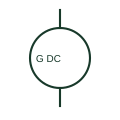

# DC generator

A DC generator converts mechanical input into a documented DC electrical output.

[Canonical reference](https://eloragrid.ai/symbols/dc-generator) · [Structured record](../entries/dc-generator.json) · [All references](README.md)

Updated: 2026-10-27. Drawing use: SLD, Schematic. Reference families: IEC, Manufacturer.

## What it represents

A DC generator converts mechanical input into a documented DC electrical output. Its output polarity and excitation arrangement must be identified where they affect the connected system.

## How to read it

- Follow the excitation circuit separately when the selected machine requires it.
- The preview is an original explanation of this function. Match the actual drawing convention to its legend and the selected equipment documentation.

## Drawing checklist

- State DC output rating
- Mark polarity
- Reference excitation and control

## Important distinction

A generator supplies a source; a DC motor represents a load even if the machine principles are related.

## Facts

- Drawing role: Generating source
- Representation scope: Functional concept; not an official standard graphic or a product footprint
- Public vendor block reference: HPW1G9, VPW1G9 (Autodesk identifiers; not IEC symbol numbers)
- Identifier status: The short label is a functional lookup label, not an assigned IEC or IEEE symbol number. Any separately listed Autodesk code is a verified vendor block name.

## Public references

- [Generator symbol variants](https://help.autodesk.com/cloudhelp/2021/ENU/AutoCAD-Electrical/files/GUID-09BE3BB5-9118-4302-8061-3888692E538F.htm) — Autodesk. Public documentation of this equipment function or named vendor variant; the illustration is independently authored and is not the source graphic.

## Related references

- [Generator](generator.md)
- [Synchronism check](25-synchronism-check.md)

Original educational concept geometry, CC BY 4.0. Unitless; not a certified standards glyph or manufacturer footprint.

Elora-authored explanations are CC BY 4.0. Linked standards and manufacturer material retain their own rights. Confirm project requirements using primary sources.
