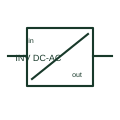

# DC-to-AC inverter

A DC/AC inverter converts a documented DC supply into an AC output.

[Canonical reference](https://eloragrid.ai/symbols/dc-to-ac-inverter) · [Structured record](../entries/dc-to-ac-inverter.json) · [All references](README.md)

Updated: 2026-10-27. Drawing use: SLD, Schematic. Reference families: Manufacturer.

## What it represents

A DC/AC inverter converts a documented DC supply into an AC output. The output waveform, voltage, frequency and operating mode belong in the equipment and control records.

## How to read it

- Distinguish a standalone AC output from an inverter intended to follow a network.
- The preview is an original explanation of this function. Match the actual drawing convention to its legend and the selected equipment documentation.

## Drawing checklist

- State DC input rating
- State AC output parameters
- Reference operating mode

## Important distinction

A DC/AC inverter is a conversion stage; its system-control capabilities depend on the selected equipment.

## Facts

- Drawing role: Energy conversion
- Representation scope: Functional concept; not an official standard graphic or a product footprint
- Identifier status: The short label is a functional lookup label, not an assigned IEC or IEEE symbol number. Any separately listed Autodesk code is a verified vendor block name.

## Public references

- [AC/DC power supplies and DC/DC converters](https://www.phoenixcontact.com/en-gb/products/power-supplies/power-supplies-with-maximum-functionality) — Phoenix Contact. Public documentation of this equipment function or named vendor variant; the illustration is independently authored and is not the source graphic.
- [Photovoltaic technology and inverter functions](https://www.electrical-installation.org/enwiki/Photovoltaic_background%2C_technology) — Schneider Electric. Public documentation of this equipment function or named vendor variant; the illustration is independently authored and is not the source graphic.

## Related references

- [Power converter / inverter](power-converter.md)
- [Battery](battery.md)

Original educational concept geometry, CC BY 4.0. Unitless; not a certified standards glyph or manufacturer footprint.

Elora-authored explanations are CC BY 4.0. Linked standards and manufacturer material retain their own rights. Confirm project requirements using primary sources.
