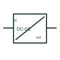

# DC-to-DC converter

A DC/DC converter changes a documented DC input into another DC output.

[Canonical reference](https://eloragrid.ai/symbols/dc-to-dc-converter) · [Structured record](../entries/dc-to-dc-converter.json) · [All references](README.md)

Updated: 2026-10-27. Drawing use: SLD, Schematic. Reference families: Manufacturer.

## What it represents

A DC/DC converter changes a documented DC input into another DC output. Isolation, regulation and polarity depend on the selected model and must not be inferred from the conversion label.

## How to read it

- Check whether input and output commons are connected internally.
- The preview is an original explanation of this function. Match the actual drawing convention to its legend and the selected equipment documentation.

## Drawing checklist

- State input/output ratings
- Identify isolation specification
- Show input/output polarity

## Important distinction

A DC/DC conversion function does not automatically provide galvanic isolation.

## Facts

- Drawing role: Energy conversion
- Representation scope: Functional concept; not an official standard graphic or a product footprint
- Identifier status: The short label is a functional lookup label, not an assigned IEC or IEEE symbol number. Any separately listed Autodesk code is a verified vendor block name.

## Public references

- [AC/DC power supplies and DC/DC converters](https://www.phoenixcontact.com/en-gb/products/power-supplies/power-supplies-with-maximum-functionality) — Phoenix Contact. Public documentation of this equipment function or named vendor variant; the illustration is independently authored and is not the source graphic.

## Related references

- [Power converter / inverter](power-converter.md)
- [Battery](battery.md)

Original educational concept geometry, CC BY 4.0. Unitless; not a certified standards glyph or manufacturer footprint.

Elora-authored explanations are CC BY 4.0. Linked standards and manufacturer material retain their own rights. Confirm project requirements using primary sources.
