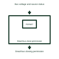

# Dead-bus close permission

Allows the documented source to energize a bus established as dead by its voltage checks.

[Canonical reference](https://eloragrid.ai/symbols/dead-bus-close-permission) · [Structured record](../entries/dead-bus-close-permission.json) · [All references](README.md)

Updated: 2026-11-03. Drawing use: Schematic. Reference families: Manufacturer.

Representation: functional-block; installation focus: switchgear.
Bus voltage and source status
Dead-bus closing permission

## What it represents

Allows the documented source to energize a bus established as dead by its voltage checks. A closing circuit combines an operator or automatic request with the conditions that allow the breaker to close. The closing coil releases stored mechanism energy where that construction is used; it is different from the spring-charging motor.
In a switchgear bus-coupler panel, a close request is checked against position, mechanism readiness and the selected live-bus or dead-bus conditions before the closing circuit is enabled. For this reference, the drawing identifies “Bus voltage and source status” at the input and “Dead-bus closing permission” at the output. Loss of voltage sensing is not proof of a dead bus.
Follow request, permission and final coil output as separate signals. A permissive diagram must say which conditions block closing and what happens if a feedback signal becomes unavailable. The functional block is an independent explanation of this named application. Equipment-specific ratings, terminal connections and operating conditions must be established in the project documentation.

## How to read it

- Start at the named input: Bus voltage and source status. Identify its source device or document and the state represented on the drawing.
- Follow the named output: Dead-bus closing permission. Cross-reference its destination and separate the command from confirmation that the equipment responded.
- Loss of voltage sensing is not proof of a dead bus.
- Follow request, permission and final coil output as separate signals. A permissive diagram must say which conditions block closing and what happens if a feedback signal becomes unavailable.

## Drawing checklist

- Label the source and connection reference for bus voltage and source status.
- Identify the destination and defined state of dead-bus closing permission.
- Record the equipment or control-document revision supporting this functional block.
- Check this application limit in the project design: Loss of voltage sensing is not proof of a dead bus.

## Important distinction

Loss of voltage sensing is not proof of a dead bus. This reference describes the named application; it does not establish a new IEC graphical symbol, an ANSI device-function number or an exact manufacturer connection diagram.

## Facts

- Representation: Functional block
- Installation focus: Switchgear
- Input / boundary: Bus voltage and source status
- Output / connection: Dead-bus closing permission
- Lookup label: DCP is a library lookup label, not a standard device designation.

## Public references

- [Masterclad medium-voltage switchgear: circuit-breaker section interlocks](https://productinfo.se.com/masterclad_mv_switchgear_ib/6055-30-masterclad-15kv-mv-switchgear-ib/English/6055-30%20Masterclad%20MV%20Switchgear%20Indoor%20%28bookmap%29_DD00646805.xml/%24/Section6-CircuitBreakerSectionInter-58DD6EC7) — Schneider Electric. Public technical context for breaker closing controls. Breaker control, mechanism, position contacts, racking interlocks and test interfaces. The application text and educational graphic are independently authored; the publisher does not certify this representation.

## Related references

- [Circuit breaker](circuit-breaker.md)
- [Synchronism check](25-synchronism-check.md)
- [Live-bus synchronised closing gate](live-bus-synchronised-closing-gate.md)

Original educational concept geometry, CC BY 4.0. Unitless; not a certified standards glyph or manufacturer footprint.

Elora-authored explanations are CC BY 4.0. Linked standards and manufacturer material retain their own rights. Confirm project requirements using primary sources.
