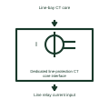

# Dedicated line-protection CT core interface

Identifies the assigned line-bay CT circuit serving its protective relay.

[Canonical reference](https://eloragrid.ai/symbols/dedicated-line-protection-ct-core-interface) · [Structured record](../entries/dedicated-line-protection-ct-core-interface.json) · [All references](README.md)

Updated: 2026-11-03. Drawing use: Schematic. Reference families: Manufacturer.

Representation: functional-block; installation focus: substations.
Line-bay CT core
Line relay current input

## What it represents

Identifies the assigned line-bay CT circuit serving its protective relay. A current-transformer secondary arrangement carries a measuring current from a defined primary location to metering or protection inputs. Core identity, polarity and the connected circuit determine the measurement's meaning.
In a substation protection panel, separate CT cores can supply metering and protection circuits with different duties. A test boundary must preserve the secondary arrangement required by the selected CT and test device. For this reference, the drawing identifies “Line-bay CT core” at the input and “Line relay current input” at the output. The bay measurement boundary must be stated.
Trace every secondary connection and the assigned earthing point against the actual connection diagram. These illustrations explain circuit roles and never prescribe a live CT switching or disconnection procedure. The functional block is an independent explanation of this named application. Equipment-specific ratings, terminal connections and operating conditions must be established in the project documentation.

## How to read it

- Start at the named input: Line-bay CT core. Identify its source device or document and the state represented on the drawing.
- Follow the named output: Line relay current input. Cross-reference its destination and separate the command from confirmation that the equipment responded.
- The bay measurement boundary must be stated.
- Trace every secondary connection and the assigned earthing point against the actual connection diagram. These illustrations explain circuit roles and never prescribe a live CT switching or disconnection procedure.

## Drawing checklist

- Label the source and connection reference for line-bay ct core.
- Identify the destination and defined state of line relay current input.
- Record the equipment or control-document revision supporting this functional block.
- Check this application limit in the project design: The bay measurement boundary must be stated.

## Important distinction

The bay measurement boundary must be stated. This reference describes the named application; it does not establish a new IEC graphical symbol, an ANSI device-function number or an exact manufacturer connection diagram.

## Facts

- Representation: Functional block
- Installation focus: Substations
- Input / boundary: Line-bay CT core
- Output / connection: Line relay current input
- Lookup label: DLCCI is a library lookup label, not a standard device designation.

## Public references

- [Indoor current and voltage transformers](https://www.abb.com/gb/en/areas/electrification/medium-voltage/grid-components/core-components/indoor-instrument-transformers) — ABB. Public technical context for current-transformer secondary arrangements. Current and voltage measurement transformers and their secondary interfaces. The application text and educational graphic are independently authored; the publisher does not certify this representation.

## Related references

- [Current transformer](current-transformer.md)
- [CT test terminal](ct-test-terminal.md)
- [CT secondary star-point connection](ct-secondary-star-point-connection.md)

Original educational concept geometry, CC BY 4.0. Unitless; not a certified standards glyph or manufacturer footprint.

Elora-authored explanations are CC BY 4.0. Linked standards and manufacturer material retain their own rights. Confirm project requirements using primary sources.
