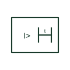

# Definite-time delay qualifier for measuring relays

Qualifier added to a measuring relay symbol to show that operation follows a fixed time delay after pick-up.

[Canonical reference](https://eloragrid.ai/symbols/definite-time-delay-measuring-qualifier) · [Structured record](../entries/definite-time-delay-measuring-qualifier.json) · [All references](README.md)

Updated: 2026-10-28. Drawing use: Schematic, SLD. Reference families: IEC.

## What it represents

This qualifier is added inside or beside a measuring relay box to show that the relay operates a fixed time after its measured quantity crosses the threshold. Combined with a quantity such as I\> or U\<, it tells the reader the element is definite-time rather than instantaneous or inverse-time.
The qualifier states the type of delay, not its value. The delay setting itself must appear in the settings table, and an element shown without any time qualifier should not automatically be assumed to be instantaneous unless the legend says so.

## How to read it

- Read the qualifier together with the quantity and threshold sign.
- Take the actual delay value from the settings record.

## Drawing checklist

- Pair with quantity and threshold
- State delay setting
- Confirm legend convention

## Important distinction

A definite-time qualifier gives a fixed delay; an inverse-time qualifier gives a delay that shortens as the quantity increases.

## Facts

- Meaning: Fixed delay after pick-up
- Applies to: Measuring relay symbols
- Preview: Independent educational concept; consult the applicable standard and project legend for the exact graphic

## Public references

- [IEC graphical symbols for diagrams](https://tc3.iec.ch/tc-activity/graphical-symbols-for-diagrams/) — IEC. IEC context for graphical symbols used in diagrams; no IEC graphic is reproduced.
- [Autodesk IEC-60617 preview: Operating-device and function qualifiers](https://help.autodesk.com/cloudhelp/2021/ENU/AutoCAD-Electrical/files/GUID-3598E18D-9F8A-48CE-83D0-4CEBA0AE869C.htm) — Autodesk. Public IEC-context qualifier family showing how qualifiers modify a base symbol.

## Related references

- [Inverse-time characteristic qualifier](inverse-time-characteristic-qualifier.md)
- [Measuring relay](measuring-relay.md)
- [Maximum-current monitoring relay](maximum-current-monitoring-relay.md)

Original educational concept geometry, CC BY 4.0. Unitless; not a certified standards glyph or manufacturer footprint.

Elora-authored explanations are CC BY 4.0. Linked standards and manufacturer material retain their own rights. Confirm project requirements using primary sources.
