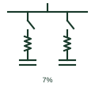

# Detuned capacitor bank

Power factor correction capacitors with series reactors that tune each step below the lowest significant harmonic.

[Canonical reference](https://eloragrid.ai/symbols/detuned-capacitor-bank) · [Structured record](../entries/detuned-capacitor-bank.json) · [All references](README.md)

Updated: 2026-10-28. Drawing use: SLD. Reference families: IEC, IEEE / ANSI.

## What it represents

A detuned capacitor bank places a reactor in series with each capacitor step so that the step resonates at a frequency below the lowest significant harmonic, commonly expressed as a detuning factor such as 7 per cent, which tunes near 189 Hz on a 50 Hz network. This prevents the bank from forming a parallel resonance that would amplify 5th harmonic currents from converters.
Single-line diagrams show several capacitor steps, each with a series reactor and a switching contactor or thyristor switch, controlled by a power factor regulator using a current transformer on the incoming supply. The detuning factor is noted on the bank.
The series reactor raises the voltage across the capacitors above network voltage, so the capacitors must be rated accordingly. The symbol does not show that voltage rise, the reactor thermal rating or the regulator settings.

## How to read it

- Read the detuning factor, usually given as a percentage.
- Capacitor voltage rating should exceed network voltage.

## Drawing checklist

- State kvar per step and detuning factor.
- Show reactors, switching and regulator CT.
- Reference capacitor voltage rating.

## Important distinction

A detuned bank avoids resonance and absorbs little harmonic current; a tuned filter is designed to sink harmonic current.

## Facts

- Elements: Capacitor steps with series reactors
- Detuning factor: Commonly 5.67, 7 or 14 per cent
- Purpose: Power factor correction without resonance
- Preview: Independent educational illustration; consult the applicable standard and project legend for the exact graphic

## Public references

- [Capacitor and filter product offerings](https://www.hitachienergy.com/products-and-solutions/capacitors-and-filters) — Hitachi Energy. Public shunt compensation banks with and without reactors context.
- [Capacitive component symbols](https://help.autodesk.com/cloudhelp/2021/ENU/AutoCAD-Electrical/files/GUID-74580D46-0731-41A6-918D-2DB419114207.htm) — Autodesk. Public capacitor symbol family context.

## Related references

- [Three-phase power-factor capacitor](three-phase-power-factor-capacitor.md)
- [Single-tuned harmonic filter](single-tuned-harmonic-filter.md)
- [Thyristor-switched capacitor](thyristor-switched-capacitor.md)
- [Iron-core reactor](iron-core-reactor.md)

Original educational concept geometry, CC BY 4.0. Unitless; not a certified standards glyph or manufacturer footprint.

Elora-authored explanations are CC BY 4.0. Linked standards and manufacturer material retain their own rights. Confirm project requirements using primary sources.
