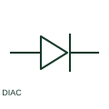

# DIAC

A DIAC is a bidirectional triggering semiconductor device used in a documented control circuit.

[Canonical reference](https://eloragrid.ai/symbols/diac) · [Structured record](../entries/diac.json) · [All references](README.md)

Updated: 2026-10-27. Drawing use: Schematic. Reference families: IEC, Manufacturer.

## What it represents

A DIAC is a bidirectional triggering semiconductor device used in a documented control circuit. Its terminals and breakover characteristics are defined by the selected component.

## How to read it

- Follow the trigger circuit rather than treating the device as a controlled switch with a separate gate.
- The preview is an original explanation of this function. Match the actual drawing convention to its legend and the selected equipment documentation.

## Drawing checklist

- Identify connected terminals
- Reference breakover rating
- Show associated trigger network

## Important distinction

A DIAC does not have the same controlled gate terminal as a TRIAC.

## Facts

- Drawing role: Semiconductor function
- Representation scope: Functional concept; not an official standard graphic or a product footprint
- Public vendor block reference: HDI1V3, VDI1V3 (Autodesk identifiers; not IEC symbol numbers)
- Identifier status: The short label is a functional lookup label, not an assigned IEC or IEEE symbol number. Any separately listed Autodesk code is a verified vendor block name.

## Public references

- [AutoCAD Electrical: Semiconductor components](https://help.autodesk.com/cloudhelp/2021/ENU/AutoCAD-Electrical/files/GUID-AC954072-7314-4682-88AF-38160D61E9A2.htm) — Autodesk. Public documentation of this equipment function or named vendor variant; the illustration is independently authored and is not the source graphic.

## Related references

- [Resistor](resistor.md)
- [Power converter / inverter](power-converter.md)

Original educational concept geometry, CC BY 4.0. Unitless; not a certified standards glyph or manufacturer footprint.

Elora-authored explanations are CC BY 4.0. Linked standards and manufacturer material retain their own rights. Confirm project requirements using primary sources.
