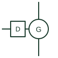

# Diesel generator set

A compression-ignition engine coupled to an alternator, shown as a source on microgrid and standby power single-line diagrams.

[Canonical reference](https://eloragrid.ai/symbols/diesel-generator-set) · [Structured record](../entries/diesel-generator-set.json) · [All references](README.md)

Updated: 2026-10-28. Drawing use: SLD. Reference families: IEC, IEEE / ANSI, Manufacturer.

## What it represents

A diesel generator set combines a diesel engine, an alternator, a controller and usually a generator breaker into one package. On a microgrid single-line diagram it is the dispatchable source that sets voltage and frequency when the utility is absent, or that supports the battery during long periods of low renewable output.
It is commonly drawn as a generator circle with an engine box or the letters DG or D beside the mechanical coupling, followed by the generator breaker and its protection relay. Ratings are often written as prime, continuous or standby, because the same set can carry different loads under each duty definition.
The symbol does not tell you minimum loading limits, fuel autonomy or the governor and regulator settings needed to share load with other sources. Light loading of diesel engines causes wet stacking, so microgrid controls often maintain a minimum genset load that the diagram does not show.

## How to read it

- Check whether the rating shown is standby, prime or continuous.
- Follow the controller connections to see whether the set can parallel with other sources.

## Drawing checklist

- State kVA, kW, power factor and duty rating.
- Show generator breaker and neutral earthing.
- Reference controller and fuel system drawings.

## Important distinction

A diesel set uses compression ignition and liquid fuel; a gas engine set uses spark ignition and gaseous fuel with different load-acceptance behaviour.

## Facts

- Prime mover: Diesel reciprocating engine
- Typical role: Standby or grid-forming backup source
- Duty ratings: Standby, prime, continuous
- Preview: Independent educational illustration; not a manufacturer outline

## Public references

- [T-030 liquid-cooled generator set application manual](https://www.cummins.com/sites/default/files/2024-08/t030-Liquid-cooled-gen-set-application-manual.pdf) — Cummins. Public generator-set application manual for ratings and installation context.
- [Generator switchgear and paralleling controls](https://www.cummins.com/en-na/generators/products/switchgear) — Cummins. Public generator switchgear and paralleling control context.

## Related references

- [Generator package](generator-package.md)
- [Three-phase synchronous generator](three-phase-synchronous-generator.md)
- [Genset controller](genset-controller.md)
- [Gas engine generator set](gas-engine-generator-set.md)

Original educational concept geometry, CC BY 4.0. Unitless; not a certified standards glyph or manufacturer footprint.

Elora-authored explanations are CC BY 4.0. Linked standards and manufacturer material retain their own rights. Confirm project requirements using primary sources.
