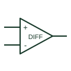

# Difference amplifier

Produces an analogue output related to the difference between two input signals with the documented gain/reference arrangement.

[Canonical reference](https://eloragrid.ai/symbols/difference-amplifier) · [Structured record](../entries/difference-amplifier.json) · [All references](README.md)

Updated: 2026-10-27. Drawing use: Schematic. Reference families: Manufacturer.

## What it represents

Produces an analogue output related to the difference between two input signals with the documented gain/reference arrangement.
On a schematic, identify the two inputs, resistor-ratio or integrated-gain definition and reference terminal and trace the difference signal and its receiving circuit. Keep the component tag and signal/reference names consistent across the control drawing, terminal schedule and device documentation.
A difference amplifier rejects common input content according to its implementation; it does not establish galvanic isolation.
Terminal letters describe electrical roles, not package pin numbers. Check the selected public datasheet for the actual pin assignment, polarity and any internally connected terminals before completing the drawing.

## How to read it

- Identify the two inputs, resistor-ratio or integrated-gain definition and reference terminal.
- Trace the difference signal and its receiving circuit.

## Drawing checklist

- Label the two inputs, resistor-ratio or integrated-gain definition and reference terminal.
- Cross-reference the difference signal and its receiving circuit.
- Add the selected device or circuit documentation revision, power/reference connections and project signal convention.

## Important distinction

A difference amplifier rejects common input content according to its implementation; it does not establish galvanic isolation.

## Facts

- Common schematic mnemonic: DIFF-AMP — descriptive only; project/device documentation defines reference designations.
- Terminal / interface focus: The two inputs, resistor-ratio or integrated-gain definition and reference terminal
- Artwork scope: Original educational component glyph; not a certified standard graphic or package pinout.

## Public references

- [AD8276 — difference amplification](https://www.analog.com/en/products/ad8276.html) — Analog Devices. Public primary manufacturer documentation establishes the component function or circuit/topology relationship. Preview geometry and drafting explanations are independently authored.

## Related references

- [Instrumentation amplifier](instrumentation-amplifier.md)
- [PLC input / output](plc-io.md)

Original educational concept geometry, CC BY 4.0. Unitless; not a certified standards glyph or manufacturer footprint.

Elora-authored explanations are CC BY 4.0. Linked standards and manufacturer material retain their own rights. Confirm project requirements using primary sources.
