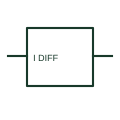

# Differential-current measuring relay

A differential-current relay responds to the relationship between specified current inputs.

[Canonical reference](https://eloragrid.ai/symbols/differential-current-measuring-relay) · [Structured record](../entries/differential-current-measuring-relay.json) · [All references](README.md)

Updated: 2026-10-27. Drawing use: SLD, Schematic. Reference families: Manufacturer.

## What it represents

A differential-current relay responds to the relationship between specified current inputs. The schematic must identify input directions, ratio matching and the protected or monitored zone.

## How to read it

- Follow polarity and reference directions on all compared current circuits.
- The preview is an original explanation of this function. Match the actual drawing convention to its legend and the selected equipment documentation.

## Drawing checklist

- Identify compared inputs
- Show polarity references
- Link setting and zone documentation

## Important distinction

Differential measurement is not simply a single high-current threshold.

## Facts

- Drawing role: Monitoring element
- Representation scope: Functional concept; not an official standard graphic or a product footprint
- Public vendor block reference: HCR1F29, VCR1F29 (Autodesk identifiers; not IEC symbol numbers)
- Identifier status: The short label is a functional lookup label, not an assigned IEC or IEEE symbol number. Any separately listed Autodesk code is a verified vendor block name.

## Public references

- [AutoCAD Electrical: Current monitoring relays](https://help.autodesk.com/cloudhelp/2021/ENU/AutoCAD-Electrical/files/GUID-E0DDA638-4664-4F1E-B191-29A4C40C4A0A.htm) — Autodesk. Public documentation of this equipment function or named vendor variant; the illustration is independently authored and is not the source graphic.

## Related references

- [Current transformer](current-transformer.md)
- [Relay coil](relay-coil.md)

Original educational concept geometry, CC BY 4.0. Unitless; not a certified standards glyph or manufacturer footprint.

Elora-authored explanations are CC BY 4.0. Linked standards and manufacturer material retain their own rights. Confirm project requirements using primary sources.
