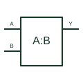

# Digital magnitude comparator

Compares two digital words to provide the specified equality and magnitude indications.

[Canonical reference](https://eloragrid.ai/symbols/digital-magnitude-comparator) · [Structured record](../entries/digital-magnitude-comparator.json) · [All references](README.md)

Updated: 2026-10-27. Drawing use: Schematic. Reference families: Manufacturer.

## What it represents

Compares two digital words to provide the specified equality and magnitude indications.
On a schematic, identify the two word buses, bit significance and cascade inputs and trace the equal, greater-than and less-than outputs. Keep the component tag and signal/reference names consistent across the control drawing, terminal schedule and device documentation.
Digital word comparison differs from an analogue voltage comparator, even though both can use a comparison block in a diagram.
The preview is an independently drawn educational functional reference. Add the selected component’s actual power pins, terminal numbers, timing or analogue reference details when producing a construction drawing.

## How to read it

- Identify the two word buses, bit significance and cascade inputs.
- Trace the equal, greater-than and less-than outputs.

## Drawing checklist

- Label the two word buses, bit significance and cascade inputs.
- Cross-reference the equal, greater-than and less-than outputs.
- Add the selected device or circuit documentation revision, power/reference connections and project signal convention.

## Important distinction

Digital word comparison differs from an analogue voltage comparator, even though both can use a comparison block in a diagram.

## Facts

- Common schematic mnemonic: MAG-COMP — descriptive only; project/device documentation defines reference designations.
- Terminal / interface focus: The two word buses, bit significance and cascade inputs
- Artwork scope: Original educational functional/circuit reference; not a selected product pinout.

## Public references

- [CD74HC85 — digital magnitude comparators](https://www.ti.com/product/CD74HC85) — Texas Instruments. Public primary manufacturer documentation establishes the component function or circuit/topology relationship. Preview geometry and drafting explanations are independently authored.

## Related references

- [Voltage comparator](voltage-comparator.md)
- [PLC input / output](plc-io.md)

Original educational concept geometry, CC BY 4.0. Unitless; not a certified standards glyph or manufacturer footprint.

Elora-authored explanations are CC BY 4.0. Linked standards and manufacturer material retain their own rights. Confirm project requirements using primary sources.
