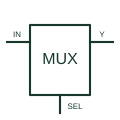

# Digital multiplexer

Selects one of several digital inputs for the documented output according to its selection controls.

[Canonical reference](https://eloragrid.ai/symbols/digital-multiplexer) · [Structured record](../entries/digital-multiplexer.json) · [All references](README.md)

Updated: 2026-10-27. Drawing use: Schematic. Reference families: Manufacturer.

## What it represents

Selects one of several digital inputs for the documented output according to its selection controls.
On a schematic, identify the data inputs, selector bits and enable polarity and trace the selected digital output and any complementary output. Keep the component tag and signal/reference names consistent across the control drawing, terminal schedule and device documentation.
A digital multiplexer processes logic levels; an analogue multiplexer passes a continuous signal within its electrical limits.
The preview is an independently drawn educational functional reference. Add the selected component’s actual power pins, terminal numbers, timing or analogue reference details when producing a construction drawing.

## How to read it

- Identify the data inputs, selector bits and enable polarity.
- Trace the selected digital output and any complementary output.

## Drawing checklist

- Label the data inputs, selector bits and enable polarity.
- Cross-reference the selected digital output and any complementary output.
- Add the selected device or circuit documentation revision, power/reference connections and project signal convention.

## Important distinction

A digital multiplexer processes logic levels; an analogue multiplexer passes a continuous signal within its electrical limits.

## Facts

- Common schematic mnemonic: MUX — descriptive only; project/device documentation defines reference designations.
- Terminal / interface focus: The data inputs, selector bits and enable polarity
- Artwork scope: Original educational functional/circuit reference; not a selected product pinout.

## Public references

- [SN74HC151 — digital multiplexing](https://www.ti.com/lit/ds/symlink/sn74hc151.pdf) — Texas Instruments. Public primary manufacturer documentation establishes the component function or circuit/topology relationship. Preview geometry and drafting explanations are independently authored.

## Related references

- [Analogue multiplexer](analog-multiplexer.md)
- [PLC input / output](plc-io.md)

Original educational concept geometry, CC BY 4.0. Unitless; not a certified standards glyph or manufacturer footprint.

Elora-authored explanations are CC BY 4.0. Linked standards and manufacturer material retain their own rights. Confirm project requirements using primary sources.
