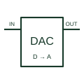

# Digital-to-analogue converter

Converts a digital code into the documented analogue output quantity.

[Canonical reference](https://eloragrid.ai/symbols/digital-to-analog-converter) · [Structured record](../entries/digital-to-analog-converter.json) · [All references](README.md)

Updated: 2026-10-27. Drawing use: Schematic. Reference families: Manufacturer.

## What it represents

Converts a digital code into the documented analogue output quantity.
On a schematic, identify the input data interface, reference and output-stage arrangement and trace the analogue voltage/current output and load. Keep the component tag and signal/reference names consistent across the control drawing, terminal schedule and device documentation.
A DAC generates an analogue representation of a code; it is not a pulse-width-modulated power converter by definition.
The preview is an independently drawn educational functional reference. Add the selected component’s actual power pins, terminal numbers, timing or analogue reference details when producing a construction drawing.

## How to read it

- Identify the input data interface, reference and output-stage arrangement.
- Trace the analogue voltage/current output and load.

## Drawing checklist

- Label the input data interface, reference and output-stage arrangement.
- Cross-reference the analogue voltage/current output and load.
- Add the selected device or circuit documentation revision, power/reference connections and project signal convention.

## Important distinction

A DAC generates an analogue representation of a code; it is not a pulse-width-modulated power converter by definition.

## Facts

- Common schematic mnemonic: DAC — descriptive only; project/device documentation defines reference designations.
- Terminal / interface focus: The input data interface, reference and output-stage arrangement
- Artwork scope: Original educational functional/circuit reference; not a selected product pinout.

## Public references

- [AD5686R — digital-to-analogue conversion](https://www.analog.com/en/products/ad5686r.html) — Analog Devices. Public primary manufacturer documentation establishes the component function or circuit/topology relationship. Preview geometry and drafting explanations are independently authored.

## Related references

- [PLC analog output](plc-analog-output.md)
- [PLC input / output](plc-io.md)

Original educational concept geometry, CC BY 4.0. Unitless; not a certified standards glyph or manufacturer footprint.

Elora-authored explanations are CC BY 4.0. Linked standards and manufacturer material retain their own rights. Confirm project requirements using primary sources.
