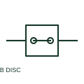

# Disconnect terminal block

A disconnect terminal includes a documented separable path for circuit isolation or testing at the wiring level.

[Canonical reference](https://eloragrid.ai/symbols/disconnect-terminal-block) · [Structured record](../entries/disconnect-terminal-block.json) · [All references](README.md)

Updated: 2026-10-27. Drawing use: Schematic. Reference families: Manufacturer.

## What it represents

A disconnect terminal includes a documented separable path for circuit isolation or testing at the wiring level. Its reference operating state and terminal identity must be shown.

## How to read it

- Identify the circuit path opened by the disconnect element.
- The preview is an original explanation of this function. Match the actual drawing convention to its legend and the selected equipment documentation.

## Drawing checklist

- Label disconnect function
- Show connected circuits
- Reference normal/service position

## Important distinction

A disconnect terminal is not automatically suitable for load interruption or for every CT testing arrangement.

## Facts

- Drawing role: Wiring interface
- Representation scope: Functional concept; not an official standard graphic or a product footprint
- Identifier status: The short label is a functional lookup label, not an assigned IEC or IEEE symbol number. Any separately listed Autodesk code is a verified vendor block name.

## Public references

- [Terminal block functional families](https://www.phoenixcontact.com/en-gb/products/terminal-blocks) — Phoenix Contact. Public documentation of this equipment function or named vendor variant; the illustration is independently authored and is not the source graphic.

## Related references

- [Terminal connection](terminal.md)
- [Terminal strip assembly](terminal-strip.md)

Original educational concept geometry, CC BY 4.0. Unitless; not a certified standards glyph or manufacturer footprint.

Elora-authored explanations are CC BY 4.0. Linked standards and manufacturer material retain their own rights. Confirm project requirements using primary sources.
