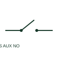

# Disconnector auxiliary NO contact

A normally-open disconnector auxiliary contact provides a separate indication or permissive circuit associated with the disconnector mechanism.

[Canonical reference](https://eloragrid.ai/symbols/disconnector-auxiliary-no-contact) · [Structured record](../entries/disconnector-auxiliary-no-contact.json) · [All references](README.md)

Updated: 2026-10-27. Drawing use: SLD, Schematic. Reference families: IEC, Manufacturer.

## What it represents

A normally-open disconnector auxiliary contact provides a separate indication or permissive circuit associated with the disconnector mechanism. Its state is read against the documented reference position.

## How to read it

- The contact tag must link to the disconnector rather than to an unrelated relay coil.
- The preview is an original explanation of this function. Match the actual drawing convention to its legend and the selected equipment documentation.

## Drawing checklist

- State reference disconnector position
- Identify auxiliary terminals
- Link the main-device tag

## Important distinction

Auxiliary contacts report or interlock operation; they do not carry the feeder load.

## Facts

- Drawing role: Switching path
- Representation scope: Functional concept; not an official standard graphic or a product footprint
- Public vendor block reference: HDS21AUX, VDS21AUX (Autodesk identifiers; not IEC symbol numbers)
- Identifier status: The short label is a functional lookup label, not an assigned IEC or IEEE symbol number. Any separately listed Autodesk code is a verified vendor block name.

## Public references

- [AutoCAD Electrical: Additional circuit-breaker poles](https://help.autodesk.com/cloudhelp/2021/ENU/AutoCAD-Electrical/files/GUID-8B9070E1-A978-429D-A552-27BEFAE1C60E.htm) — Autodesk. Public documentation of this equipment function or named vendor variant; the illustration is independently authored and is not the source graphic.
- [AutoCAD Electrical: Fusible disconnects](https://help.autodesk.com/cloudhelp/2021/ENU/AutoCAD-Electrical/files/GUID-FE7E6B30-F585-41F4-9F66-215ACD95A36D.htm) — Autodesk. Public documentation of this equipment function or named vendor variant; the illustration is independently authored and is not the source graphic.

## Related references

- [Disconnector](disconnector.md)
- [Circuit breaker](circuit-breaker.md)

Original educational concept geometry, CC BY 4.0. Unitless; not a certified standards glyph or manufacturer footprint.

Elora-authored explanations are CC BY 4.0. Linked standards and manufacturer material retain their own rights. Confirm project requirements using primary sources.
