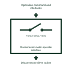

# Disconnector motor operator interface

Shows command and position feedback for the selected motor-operated disconnector.

[Canonical reference](https://eloragrid.ai/symbols/disconnector-motor-operator-interface) · [Structured record](../entries/disconnector-motor-operator-interface.json) · [All references](README.md)

Updated: 2026-11-03. Drawing use: Schematic. Reference families: Manufacturer.

Representation: functional-block; installation focus: switchgear.
Operation command and interlocks
Disconnector drive action

## What it represents

Shows command and position feedback for the selected motor-operated disconnector. A switching-device operating reference adds the specific mechanism or duty context needed to interpret its place in a power circuit. The same basic switching outline can serve different equipment constructions, so the added description must remain attached to its device tag.
In a medium-voltage switchgear drawing, the operating reference helps the reader distinguish the interrupting device from its isolation, earthing and auxiliary-control interfaces. For this reference, the drawing identifies “Operation command and interlocks” at the input and “Disconnector drive action” at the output. A disconnector is not generally a fault interrupter.
Use the device schedule for its actual construction, operating duty and ratings. These original functional illustrations describe the named role and do not certify a standard glyph or product footprint. The functional block is an independent explanation of this named application. Equipment-specific ratings, terminal connections and operating conditions must be established in the project documentation.

## How to read it

- Start at the named input: Operation command and interlocks. Identify its source device or document and the state represented on the drawing.
- Follow the named output: Disconnector drive action. Cross-reference its destination and separate the command from confirmation that the equipment responded.
- A disconnector is not generally a fault interrupter.
- Use the device schedule for its actual construction, operating duty and ratings. These original functional illustrations describe the named role and do not certify a standard glyph or product footprint.

## Drawing checklist

- Label the source and connection reference for operation command and interlocks.
- Identify the destination and defined state of disconnector drive action.
- Record the equipment or control-document revision supporting this functional block.
- Check this application limit in the project design: A disconnector is not generally a fault interrupter.

## Important distinction

A disconnector is not generally a fault interrupter. This reference describes the named application; it does not establish a new IEC graphical symbol, an ANSI device-function number or an exact manufacturer connection diagram.

## Facts

- Representation: Functional block
- Installation focus: Switchgear
- Input / boundary: Operation command and interlocks
- Output / connection: Disconnector drive action
- Lookup label: DMOI is a library lookup label, not a standard device designation.

## Public references

- [High-voltage circuit breakers](https://www.siemens-energy.com/global/en/home/products-services/product-offerings/circuit-breakers.html) — Siemens Energy. Public technical context for switching-device operating references. Circuit-breaker construction and interruption families. The application text and educational graphic are independently authored; the publisher does not certify this representation.

## Related references

- [Circuit breaker](circuit-breaker.md)
- [Disconnector](disconnector.md)
- [Earthing-switch motor operator interface](earthing-switch-motor-operator-interface.md)

Original educational concept geometry, CC BY 4.0. Unitless; not a certified standards glyph or manufacturer footprint.

Elora-authored explanations are CC BY 4.0. Linked standards and manufacturer material retain their own rights. Confirm project requirements using primary sources.
