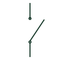

# Disconnector

A switching device providing an electrical isolation function.

[Canonical reference](https://eloragrid.ai/symbols/disconnector) · [Structured record](../entries/disconnector.json) · [All references](README.md)

Updated: 2026-10-27. Drawing use: SLD, Schematic. Reference families: IEC, IEEE / ANSI.

## What it represents

A disconnector, often called an isolator, provides an isolation function in an electrical circuit. Its representation should be read with the drawing legend and the selected device specification. Do not infer load-breaking or fault-interruption capability simply because a drawing contains a switch-like mark.
In a switchgear SLD the disconnector may appear next to a breaker, earthing switch or bus section. Control drawings can also show position indications and interlocking. The main-circuit representation and the auxiliary indications describe different parts of the equipment.

## How to read it

- Identify which circuit segment is isolated by the device.
- Distinguish the main switching function from its auxiliary position contacts.

## Drawing checklist

- Link the selected device and its isolation capability.
- Reference the position indication and interlock documentation.
- Show associated earthing arrangements where applicable.

## Important distinction

A load-break switch has a specified load-switching capability. A disconnector designation alone does not establish that capability.

## Facts

- Primary role: Isolation
- Capability: Confirm against the selected device
- Related device number: 89: line switch, where the convention applies

## Public references

- [Elementary switching devices](https://www.electrical-installation.org/enwiki/Elementary_switching_devices) — Schneider Electric — Electrical Installation Guide. Manufacturer explanation of disconnector and load-breaking functions.
- [Secondary-distribution switchgear and ring main units](https://new.abb.com/medium-voltage/switchgear/secondary-distribution) — ABB. Public secondary-distribution switchgear context.

## Related references

- [Load-break switch](load-break-switch.md)
- [Circuit breaker](circuit-breaker.md)
- [Earthing switch](earthing-switch.md)
- [Line switch](89-line-switch.md)

Original educational concept geometry, CC BY 4.0. Unitless; not a certified standards glyph or manufacturer footprint.

Elora-authored explanations are CC BY 4.0. Linked standards and manufacturer material retain their own rights. Confirm project requirements using primary sources.
