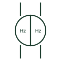

# Double frequency meter

Instrument with two frequency elements showing running and incoming frequency together on a synchronising panel.

[Canonical reference](https://eloragrid.ai/symbols/double-frequency-meter) · [Structured record](../entries/double-frequency-meter.json) · [All references](README.md)

Updated: 2026-10-28. Drawing use: SLD, Schematic. Reference families: IEC, Manufacturer.

## What it represents

A double frequency meter shows the frequency of the running system and the incoming machine on one instrument. During manual synchronising the operator adjusts the incoming governor until the two readings match closely, then uses the synchroscope for final phase alignment.
The meter shows frequency only and gives no information on phase angle. Closing with matched frequencies but a large phase difference can still cause a severe disturbance, so it must always be read with the synchroscope or check-synchronising relay.

## How to read it

- Identify running and incoming inputs.
- Read together with the synchroscope.

## Drawing checklist

- Label both inputs
- Show VT sources
- Reference synchronising check

## Important distinction

A double frequency meter compares frequency; a synchroscope shows the phase difference and its rate of change.

## Facts

- Inputs: Running and incoming voltage
- Displayed quantity: Two frequencies
- Preview: Independent educational concept; consult the applicable standard and project legend for the exact graphic

## Public references

- [IEC graphical symbols for diagrams](https://tc3.iec.ch/tc-activity/graphical-symbols-for-diagrams/) — IEC. IEC context for graphical symbols used in diagrams; no IEC graphic is reproduced.
- [Generator switchgear and paralleling controls](https://www.cummins.com/en-na/generators/products/switchgear) — Cummins. Public context for generator paralleling controls where synchronising instruments are used.

## Related references

- [Double voltmeter](double-voltmeter.md)
- [Frequency meter](frequency-meter.md)
- [Synchronism check](25-synchronism-check.md)

Original educational concept geometry, CC BY 4.0. Unitless; not a certified standards glyph or manufacturer footprint.

Elora-authored explanations are CC BY 4.0. Linked standards and manufacturer material retain their own rights. Confirm project requirements using primary sources.
