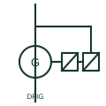

# Doubly-fed induction generator

A wound-rotor induction generator with the stator on the network and the rotor fed through a back-to-back converter sized for slip power.

[Canonical reference](https://eloragrid.ai/symbols/doubly-fed-induction-generator) · [Structured record](../entries/doubly-fed-induction-generator.json) · [All references](README.md)

Updated: 2026-10-28. Drawing use: SLD, Schematic. Reference families: IEC, IEEE / ANSI.

## What it represents

A doubly-fed induction generator has its stator connected directly to the turbine transformer while the rotor windings, reached through slip rings, connect to a back-to-back AC/DC/AC converter. The converter injects rotor currents at slip frequency, allowing variable speed of roughly plus or minus thirty per cent around synchronous speed and independent control of active and reactive power.
On a single-line diagram the generator circle shows two connections: the stator branch to the main breaker and the rotor branch to a pair of converter blocks joined by a DC link. A crowbar or DC chopper is often shown on the rotor converter for fault protection, and a line filter or reactor sits on the grid-side converter.
Because the converter only carries slip power, typically a quarter to a third of the turbine rating, the symbol does not imply full decoupling from the network. Short-circuit contribution, crowbar operation and ride-through capability depend on control settings that the diagram does not show.

## How to read it

- Follow both the stator and rotor paths; they usually join again at the turbine transformer low-voltage side.
- Identify the crowbar or chopper, since it changes fault behaviour.

## Drawing checklist

- State stator rating and rotor converter rating separately.
- Show crowbar, chopper and line filter if fitted.
- Reference grid-code ride-through data.

## Important distinction

A DFIG converter handles only rotor slip power; a full-converter turbine passes all generator output through the converter.

## Facts

- Generator type: Wound-rotor induction, slip rings
- Converter rating: Typically about 25 to 35 per cent of turbine rating
- Speed range: Variable around synchronous speed
- Preview: Independent educational illustration; consult the applicable standard and project legend for the exact graphic

## Public references

- [Bidirectional three-/single-phase AC/DC PFC and inverter application note](https://www.infineon.com/assets/row/public/documents/24/42/infineon-ac-dc-pfc-11-kw-high-efficiency-high-density-bidirectional-three-single-phase-inverter-applicationnotes-en.pdf) — Infineon Technologies. Public bidirectional AC/DC converter context relevant to the rotor-side back-to-back stage.
- [Generator symbol variants](https://help.autodesk.com/cloudhelp/2021/ENU/AutoCAD-Electrical/files/GUID-09BE3BB5-9118-4302-8061-3888692E538F.htm) — Autodesk. Public generator symbol family context; the DFIG artwork is independently drawn.

## Related references

- [Wound-rotor induction motor](wound-rotor-induction-motor.md)
- [Full-converter wind turbine generator (Type 4)](full-converter-wind-turbine-generator.md)
- [Variable-slip wind turbine generator (Type 2)](type-2-variable-slip-wind-turbine-generator.md)
- [Active front-end rectifier](active-front-end-rectifier.md)

Original educational concept geometry, CC BY 4.0. Unitless; not a certified standards glyph or manufacturer footprint.

Elora-authored explanations are CC BY 4.0. Linked standards and manufacturer material retain their own rights. Confirm project requirements using primary sources.
