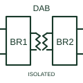

# Dual-active-bridge topology

A conversion stage with controlled bridges on both sides of a coupled magnetic link.

[Canonical reference](https://eloragrid.ai/symbols/dual-active-bridge-topology) · [Structured record](../entries/dual-active-bridge-topology.json) · [All references](README.md)

Updated: 2026-10-27. Drawing use: Schematic, SLD. Reference families: Manufacturer.

## What it represents

A conversion stage with controlled bridges on both sides of a coupled magnetic link.
On a schematic, identify the two DC ports, both active bridges and isolation boundary and trace the bidirectional energy path and bridge control references. Keep the component tag and signal/reference names consistent across the control drawing, terminal schedule and device documentation.
Two actively switched sides distinguish a DAB from a primary bridge with passive secondary rectification.
The preview is a conceptual topology reference rather than a complete power-stage circuit. Switching sequences, magnetic design, component selection and control/protection details belong in the equipment design documentation.

## How to read it

- Identify the two DC ports, both active bridges and isolation boundary.
- Trace the bidirectional energy path and bridge control references.

## Drawing checklist

- Label the two DC ports, both active bridges and isolation boundary.
- Cross-reference the bidirectional energy path and bridge control references.
- Add the selected device or circuit documentation revision, power/reference connections and project signal convention.

## Important distinction

Two actively switched sides distinguish a DAB from a primary bridge with passive secondary rectification.

## Facts

- Common schematic mnemonic: DAB — descriptive only; project/device documentation defines reference designations.
- Terminal / interface focus: The two DC ports, both active bridges and isolation boundary
- Artwork scope: Original conceptual topology block; not a complete switch-level circuit.

## Public references

- [TIDA-010054: bidirectional dual-active-bridge reference design](https://www.ti.com/tool/TIDA-010054) — Texas Instruments. Public primary manufacturer documentation establishes the component function or circuit/topology relationship. Preview geometry and drafting explanations are independently authored.

## Related references

- [Full-bridge DC converter topology](full-bridge-dc-converter-topology.md)
- [Power converter / inverter](power-converter.md)

Original educational concept geometry, CC BY 4.0. Unitless; not a certified standards glyph or manufacturer footprint.

Elora-authored explanations are CC BY 4.0. Linked standards and manufacturer material retain their own rights. Confirm project requirements using primary sources.
