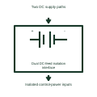

# Dual DC-feed isolation interface

Shows the isolation boundaries between two separately identified control-power feeds.

[Canonical reference](https://eloragrid.ai/symbols/dual-dc-feed-isolation-interface) · [Structured record](../entries/dual-dc-feed-isolation-interface.json) · [All references](README.md)

Updated: 2026-11-03. Drawing use: Schematic. Reference families: Manufacturer.

Representation: functional-block; installation focus: switchgear.
Two DC supply paths
Isolated control-power inputs

## What it represents

Shows the isolation boundaries between two separately identified control-power feeds. Control power supplies the command, protection and indication equipment associated with a switchgear assembly. The drawing must distinguish the source, each distribution branch and the functions lost if that branch fails.
In a switchgear lineup, separate protected branches may feed trip coils, closing coils and protection electronics. Their alarm contacts help the station controller identify which operating capability is unavailable. For this reference, the drawing identifies “Two DC supply paths” at the input and “Isolated control-power inputs” at the output. Redundancy requires assessment of common components.
Follow the actual positive, negative or neutral returns and the protective device on each branch. A healthy voltage indication does not establish that every downstream path can deliver its required operating current. The functional block is an independent explanation of this named application. Equipment-specific ratings, terminal connections and operating conditions must be established in the project documentation.

## How to read it

- Start at the named input: Two DC supply paths. Identify its source device or document and the state represented on the drawing.
- Follow the named output: Isolated control-power inputs. Cross-reference its destination and separate the command from confirmation that the equipment responded.
- Redundancy requires assessment of common components.
- Follow the actual positive, negative or neutral returns and the protective device on each branch. A healthy voltage indication does not establish that every downstream path can deliver its required operating current.

## Drawing checklist

- Label the source and connection reference for two dc supply paths.
- Identify the destination and defined state of isolated control-power inputs.
- Record the equipment or control-document revision supporting this functional block.
- Check this application limit in the project design: Redundancy requires assessment of common components.

## Important distinction

Redundancy requires assessment of common components. This reference describes the named application; it does not establish a new IEC graphical symbol, an ANSI device-function number or an exact manufacturer connection diagram.

## Facts

- Representation: Functional block
- Installation focus: Switchgear
- Input / boundary: Two DC supply paths
- Output / connection: Isolated control-power inputs
- Lookup label: DDII is a library lookup label, not a standard device designation.

## Public references

- [SEL-RPM redundant power module](https://selinc.com/products/RPM/) — SEL. Public technical context for switchgear control-power supervision. Independent AC and DC sources for station auxiliary power. The application text and educational graphic are independently authored; the publisher does not certify this representation.

## Related references

- [Relay coil](relay-coil.md)
- [AC-to-DC power supply](ac-to-dc-power-supply.md)
- [Control-power diode-decoupled feed](control-power-diode-decoupled-feed.md)

Original educational concept geometry, CC BY 4.0. Unitless; not a certified standards glyph or manufacturer footprint.

Elora-authored explanations are CC BY 4.0. Linked standards and manufacturer material retain their own rights. Confirm project requirements using primary sources.
