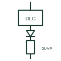

# Dump load controller

A controller that diverts surplus generation into a resistive dump load to hold frequency or voltage in a small isolated system.

[Canonical reference](https://eloragrid.ai/symbols/dump-load-controller) · [Structured record](../entries/dump-load-controller.json) · [All references](README.md)

Updated: 2026-10-28. Drawing use: SLD, Schematic. Reference families: IEC, IEEE / ANSI.

## What it represents

A dump load controller keeps a small isolated system in balance by diverting surplus power into a resistive load, usually water or air heaters. In micro hydro systems it holds frequency constant by keeping total generator load fixed, and in small wind or battery systems it protects the battery from overcharge by dumping excess energy.
Drawings show a controller block, often with a thyristor or transistor switch symbol, connected between the bus and a resistor bank labelled dump or ballast load. A frequency or voltage sensing connection to the bus is included.
The dump load must be rated to absorb the full generator output if all consumer loads disconnect. The symbol does not show that rating or the heat rejection arrangement, both important for safety.

## How to read it

- The resistor bank is a control element, not a consumer load.
- Check the sensing quantity: frequency for hydro, voltage for battery systems.

## Drawing checklist

- State dump load rating against generator rating.
- Show sensing and switching element.
- Reference heat rejection.

## Important distinction

A dump load controller diverts surplus energy continuously; a load bank is a test load used temporarily.

## Facts

- Control quantity: Frequency or DC voltage
- Load element: Resistive heaters
- Typical use: Micro hydro, small wind, off-grid systems
- Preview: Independent educational illustration; consult the applicable standard and project legend for the exact graphic

## Public references

- [Resistors and heater-element symbols](https://help.autodesk.com/cloudhelp/2021/ENU/AutoCAD-Electrical/files/GUID-1D071951-D38E-4B15-8B9E-C30ECBD55C19.htm) — Autodesk. Public resistor and heater-element symbol context.
- [AutoCAD Electrical: Semiconductor components](https://help.autodesk.com/cloudhelp/2021/ENU/AutoCAD-Electrical/files/GUID-AC954072-7314-4682-88AF-38160D61E9A2.htm) — Autodesk. Public semiconductor switch symbol context.

## Related references

- [Hydro turbine generator](hydro-turbine-generator.md)
- [Resistive load bank](resistive-load-bank.md)
- [Semiconductor power switch](semiconductor-power-switch.md)
- [Fixed-speed wind turbine generator (Type 1)](type-1-fixed-speed-wind-turbine-generator.md)

Original educational concept geometry, CC BY 4.0. Unitless; not a certified standards glyph or manufacturer footprint.

Elora-authored explanations are CC BY 4.0. Linked standards and manufacturer material retain their own rights. Confirm project requirements using primary sources.
