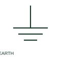

# Earth connection

An earth connection identifies a documented circuit connection to earth.

[Canonical reference](https://eloragrid.ai/symbols/earth-connection) · [Structured record](../entries/earth-connection.json) · [All references](README.md)

Updated: 2026-10-27. Drawing use: SLD, Schematic. Reference families: IEC, Manufacturer.

## What it represents

An earth connection identifies a documented circuit connection to earth. The drawing's label and context establish whether it serves system earthing, protection or another specified role.

## How to read it

- Read the connection's purpose instead of treating every earth mark as interchangeable.
- The preview is an original explanation of this function. Match the actual drawing convention to its legend and the selected equipment documentation.

## Drawing checklist

- State connection purpose
- Identify earth conductor
- Reference earthing arrangement

## Important distinction

Earth, protective earth and functional earth have different documented roles.

## Facts

- Drawing role: Earth or bonding role
- Representation scope: Functional concept; not an official standard graphic or a product footprint
- Public vendor block reference: HGND2, VGND2 (Autodesk identifiers; not IEC symbol numbers)
- Identifier status: The short label is a functional lookup label, not an assigned IEC or IEEE symbol number. Any separately listed Autodesk code is a verified vendor block name.

## Public references

- [AutoCAD Electrical: Earthing, sources and surge protection](https://help.autodesk.com/cloudhelp/2021/ENU/AutoCAD-Electrical/files/GUID-1E3FDEAE-B4B2-417C-8075-108AA2C6E509.htm) — Autodesk. Public documentation of this equipment function or named vendor variant; the illustration is independently authored and is not the source graphic.

## Related references

- [Protective earth](protective-earth.md)
- [Earthing switch](earthing-switch.md)

Original educational concept geometry, CC BY 4.0. Unitless; not a certified standards glyph or manufacturer footprint.

Elora-authored explanations are CC BY 4.0. Linked standards and manufacturer material retain their own rights. Confirm project requirements using primary sources.
