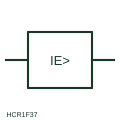

# Earth-fault current relay

Measuring relay form that operates on current flowing to earth, fed from a residual connection or core-balance CT.

[Canonical reference](https://eloragrid.ai/symbols/earth-fault-current-relay) · [Structured record](../entries/earth-fault-current-relay.json) · [All references](README.md)

Updated: 2026-10-28. Drawing use: Schematic, SLD. Reference families: IEC, Manufacturer.

## What it represents

The earth-fault current relay form identifies a relay whose operating quantity is current flowing to earth. It may be fed from a core-balance CT around all live conductors, from the residual connection of three phase CTs, or from a CT in the star-point earth lead, and the source changes its achievable sensitivity.
The relay box shows the quantity with an earth qualifier but not the setting, characteristic or whether it is directional. In resistance-earthed and isolated networks earth-fault current is small and often needs a sensitive or directional element that must be stated separately.

## How to read it

- Identify the CT arrangement that supplies the residual current.
- Check whether the element is directional or sensitive.

## Drawing checklist

- Show residual CT source
- State setting and characteristic
- Reference system earthing method

## Important distinction

An earth-fault current relay measures current to earth; an earth-fault voltage relay measures neutral displacement voltage.

## Facts

- Measured quantity: Residual or earth-fault current
- Publisher reference token: HCR1F37 (Autodesk identifier; not an IEC database ID)
- Preview: Independent educational concept; consult the publisher and applicable standard for the exact graphic

## Public references

- [AutoCAD Electrical: Current monitoring relays](https://help.autodesk.com/cloudhelp/2021/ENU/AutoCAD-Electrical/files/GUID-E0DDA638-4664-4F1E-B191-29A4C40C4A0A.htm) — Autodesk. Public AutoCAD Electrical relay listing that names the Ground Failure Current Protection block; the illustration is independently drawn.
- [Residual current and neutral-earthing protection context](https://new.abb.com/medium-voltage/digital-substations/campaigns/earth-fault-protection-portfolio/earth-fault-offering) — ABB. Public context for residual current and neutral-earthing protection.

## Related references

- [Core-balance current transformer](core-balance-current-transformer.md)
- [Residual connection of phase CTs](residual-connection-of-phase-cts.md)
- [Time overcurrent](51-time-overcurrent.md)

Original educational concept geometry, CC BY 4.0. Unitless; not a certified standards glyph or manufacturer footprint.

Elora-authored explanations are CC BY 4.0. Linked standards and manufacturer material retain their own rights. Confirm project requirements using primary sources.
